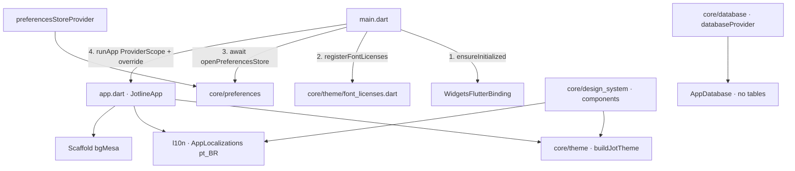
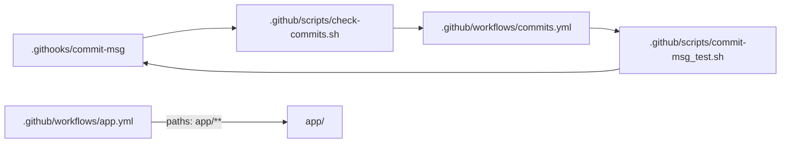

# M01 Foundation Design

**Spec**: `.specs/features/m01-foundation/spec.md`
**Context**: `.specs/features/m01-foundation/context.md`
**Status**: Approved

APIs below were checked with Context7 (Riverpod `/rrousselgit/riverpod/riverpod-v3.0.2`, Drift `/websites/drift_simonbinder_eu`, hive_ce `/io-design-team/hive_ce`, Flutter `/flutter/website`, very_good_analysis `/verygoodopensource/very_good_analysis`) and against the sources at the versions in `app/pubspec.lock` (pub cache and the FVM Flutter 3.47.5 SDK). GitHub Actions: the action's README. Where Context7 and the SDK disagree (gen-l10n `synthetic-package`), the SDK in use wins.

---

## Architecture Overview

The app becomes a thin bootstrap (`main.dart`) plus a root widget (`app.dart`). Everything this milestone builds is cross-feature, so it all lives in `lib/core/`. `lib/features/` appears with the first feature (milestone #03).

Repository-level pieces sit outside `app/`:

---

## Code Reuse Analysis

### Existing Components to Leverage

| Component | Location | How to Use |
| --- | --- | --- |
| Stack dependencies already declared | `app/pubspec.yaml` | `flutter_riverpod` 3.4.3, `drift` 2.35.2, `drift_flutter` 0.3.1, `hive_ce` 2.20.2, `hive_ce_flutter` 2.4.0, `mocktail`, `build_runner` are already in; only add `very_good_analysis`, `flutter_localizations`, `intl` |
| Test conventions | `app/.claude/docs/testes.md` | In-memory Drift per test, `ProviderContainer.test`, widget tests via `ProviderScope` overrides, requirement code first in test names |
| Design rules | `app/.claude/docs/design.md` | Canvas is the source of truth; tokens keep canvas names |
| `*.g.dart` ignore | `app/.gitignore` | Already ignores generated Drift code; extend for l10n output |
| Analyzer excludes | `app/analysis_options.yaml` | Keep `build/`, `android/`, `ios/` excludes; rewrite the rest |
| Canvas tokens and components | Canvas artboards (copied into the spec tables) | Single source for every value |

### Integration Points

| System | Integration Method |
| --- | --- |
| Drift | `AppDatabase(QueryExecutor)`; production executor `driftDatabase(name: 'jotline', native: DriftNativeOptions(databaseDirectory: getApplicationSupportDirectory))` from `drift_flutter` (Drift setup docs; default would be the documents directory) |
| hive_ce | `Hive.initFlutter()` (hive_ce_flutter) + `Hive.openBox<String>('preferences')`; tests use `Hive.init(tempDir.path)` |
| gen-l10n | `generate: true` in `pubspec.yaml` + `l10n.yaml`. In Flutter 3.47 the synthetic package is removed (the SDK fails on `synthetic-package: true` and warns on `false`, so `l10n.yaml` omits the key; Context7's page still lists the old default): output goes to the arb dir (`lib/l10n/`). `flutter pub get` regenerates it when `generate: true` |
| GitHub Actions | `subosito/flutter-action@v2` with `flutter-version-file: app/.fvmrc` (supported format) and `cache: true` |
| Fonts | Variable TTFs from `google/fonts` (`ofl/schibstedgrotesk`, `ofl/literata`) and static IBM Plex Mono; in Flutter 3.47 `FontWeight` drives the `wght` axis of variable fonts |

---

## Components

### Bootstrap — `lib/main.dart`

- **Purpose**: Initialize the binding, register font licenses, open preferences and start the app.
- **Interfaces**: `Future<void> main()`
- **Flow**: `WidgetsFlutterBinding.ensureInitialized()` → `registerFontLicenses()` → `final prefs = await openPreferencesStore()` → `runApp(ProviderScope(overrides: [preferencesStoreProvider.overrideWithValue(prefs)], child: const JotlineApp()))`.
- **Covers**: RVP-02, PREF-01, THEME-06.

### Root widget — `lib/app.dart`

- **Purpose**: `MaterialApp` with theme, localization and the empty home.
- **Interfaces**: `class JotlineApp extends StatelessWidget`
- **Details**: `theme: buildJotTheme()`, no `darkTheme`; `localizationsDelegates: AppLocalizations.localizationsDelegates`; `supportedLocales: AppLocalizations.supportedLocales` (pt only); `onGenerateTitle: (c) => AppLocalizations.of(c).appName`; `home: const Scaffold()` (background comes from `scaffoldBackgroundColor`). No `builder` that touches `MediaQuery.textScaler`.
- **Covers**: STRUCT-05, STRUCT-06, THEME-07, THEME-08.

### Localization — `lib/l10n/`

- **Files**: `l10n.yaml` (in `app/`): `arb-dir: lib/l10n`, `template-arb-file: app_pt.arb`, `output-localization-file: app_localizations.dart`, `nullable-getter: false`. Source: `lib/l10n/app_pt.arb`.
- **Generated**: `lib/l10n/app_localizations.dart`, `app_localizations_pt.dart` — not committed (`app/.gitignore`), excluded from the analyzer, regenerated by `flutter pub get`.
- **Initial keys**: `appName`, `cancel` ("Cancelar"), the six notebook color names, the four cover names, `moveItem` ("Mover {title}"), icon labels used by components (`search`, `back`, `options`).
- **Covers**: STRUCT-06, STRUCT-07.

### Database — `lib/core/database/`

- **Files**: `app_database.dart`, `database_provider.dart`
- **Interfaces**:
  - `@DriftDatabase() class AppDatabase extends _$AppDatabase { AppDatabase(super.e); int get schemaVersion => 1; }`
  - `final databaseProvider = Provider<AppDatabase>((ref) { final db = AppDatabase(driftDatabase(name: 'jotline', native: const DriftNativeOptions(databaseDirectory: getApplicationSupportDirectory))); ref.onDispose(db.close); return db; });`
- **Dependencies**: drift, drift_flutter, path_provider
- **Covers**: TEST-01, TEST-02.

### Preferences — `lib/core/preferences/`

- **Files**: `preferences_store.dart`, `hive_preferences_store.dart`, `unavailable_preferences_store.dart`, `open_preferences_store.dart`, `preferences_provider.dart`
- **Interfaces**:
  - `abstract interface class PreferencesStore { String? get lastOpenedNotebookId; Future<void> setLastOpenedNotebookId(String? id); }`
  - `HivePreferencesStore(Box<String> box)` — key `lastOpenedNotebookId`; `null` deletes the key.
  - `UnavailablePreferencesStore` — every read `null`, writes are no-ops.
  - `Future<PreferencesStore> openPreferencesStore({Future<Box<String>> Function()? openBox})` — default opener runs `Hive.initFlutter()` + `Hive.openBox<String>('preferences')`; any exception → logs via `dart:developer` `log` and returns `UnavailablePreferencesStore`. Never deletes the box.
  - `final preferencesStoreProvider = Provider<PreferencesStore>((ref) => throw UnimplementedError());` — always overridden in `main` and in tests.
- **Covers**: PREF-01…06.

### Theme — `lib/core/theme/`

The only folder allowed to hold color, font-family and raw style literals (THEME-09).

| File | Contents |
| --- | --- |
| `jot_colors.dart` | `class JotColors extends ThemeExtension<JotColors>` — 20 `final Color` fields named as in the spec table (`bgMesa` … `accentBusca`); `static const light`; `copyWith`/`lerp` |
| `jot_text_styles.dart` | `class JotTextStyles extends ThemeExtension<JotTextStyles>` — 12 `TextStyle` fields (`tituloTela` … `meta`); `factory JotTextStyles.from(JotColors)`; family constants `fontUi`, `fontTexto`, `fontMeta`. Letter spacing −0.02em is stored in logical pixels (`-0.02 * size`) |
| `jot_shadows.dart` | `class JotShadows extends ThemeExtension<JotShadows>` — `toque`, `capa`, `erguido`, `fab` as `List<BoxShadow>` |
| `jot_spacing.dart` | `abstract final class JotSpace { static const double space1 = 4 … space14 = 56; }` and `abstract final class JotRadius { rEtiqueta … rPilula = 22, rSheet = 24; static const BorderRadius rCapa = …; }` — consts so they work in `const EdgeInsets` |
| `notebook_palette.dart` | `enum NotebookColor { azulTinta(Color(0xFF2747C9)), … }`, `enum CoverPattern { lisa, pautada, pontilhada, quadriculada }`, and `abstract final class NotebookCoverPaint` with spine/elastic/pattern overlay colors and geometry from the canvas |
| `jot_theme.dart` | `ThemeData buildJotTheme()` — `useMaterial3: true`, `scaffoldBackgroundColor: bgMesa`, `ColorScheme.light(primary: accent, onPrimary: bgFolha, surface: bgFolha, onSurface: ink1, error: danger, onError: bgFolha, outline: lineBase)`, `fontFamily: fontUi`, `extensions: [JotColors.light, JotTextStyles.from(...), JotShadows.light]` |
| `theme_context.dart` | `extension JotThemeContext on BuildContext { JotColors get colors; JotTextStyles get textStyles; JotShadows get shadows; }` |
| `font_licenses.dart` | `void registerFontLicenses()` — adds one `LicenseEntryWithLineBreaks` per family from `assets/fonts/<family>/OFL.txt` |

- **Assets**: `app/assets/fonts/schibsted_grotesk/SchibstedGrotesk[wght].ttf` (declared for weights 400/500/600/700), `literata/Literata[opsz,wght].ttf` (400, 500) + `Literata-Italic[opsz,wght].ttf` (400 italic), `ibm_plex_mono/IBMPlexMono-Regular.ttf` (400) + `IBMPlexMono-Medium.ttf` (500), plus each family's `OFL.txt`. Source: `github.com/google/fonts` `ofl/` folders.
- **Covers**: THEME-01…08, THEME-10 (with the `design.md` update).

### Design system — `lib/core/design_system/`

Every widget reads tokens through `context.colors` / `context.textStyles` / `context.shadows` / `JotSpace` / `JotRadius`. Fixed labels come from `AppLocalizations`; everything else is a constructor parameter. Text that can overflow uses `maxLines` + `TextOverflow.ellipsis`.

| Canvas component | File | Public API | Covers |
| --- | --- | --- | --- |
| Botões — primário, destrutivo, pílula secundária, texto | `jot_button.dart` | `JotButton.primary/.destructive/.pill/.text({required String label, VoidCallback? onPressed})`; `null` → disabled style, no taps; min 44 × 44 | COMP-01, 02 |
| Botões — FAB | `jot_fab.dart` | `JotFab({required JotIconGlyph icon, required String label, required VoidCallback onPressed})`; `shadowFab`, `rFab` | COMP-01, 03 |
| Botões — ícone | `jot_icon_button.dart` | `JotIconButton({required JotIconGlyph icon, required String semanticLabel, required VoidCallback onPressed})` | COMP-01, 03, 04 |
| Segmentado | `jot_segmented_control.dart` | `JotSegmentedControl<T>({required List<JotSegment<T>> segments, required T selected, required ValueChanged<T> onChanged})`; `JotSegment(value, label, count)` renders "label · count"; `Semantics(selected:)` | COMP-05 |
| Campo | `jot_text_field.dart` | `JotTextField({required String label, TextEditingController? controller, ValueChanged<String>? onChanged})`; focused = `lineForte` → `accent` border | COMP-06 |
| Campo de busca | `jot_search_field.dart` | `JotSearchField({required String placeholder, TextEditingController? controller, ValueChanged<String>? onChanged})` | COMP-06 |
| Capa de caderno | `notebook_cover.dart` | `NotebookCover({required NotebookColor color, required CoverPattern pattern, String? label, double width})`; `CustomPainter` for pattern, spine, elastic | COMP-07 |
| Capa + título + meta (grade) | `notebook_cover_tile.dart` | `NotebookCoverTile({color, pattern, required String title, required String meta, VoidCallback? onTap})` | COMP-07 |
| Cor e capa | `notebook_color_picker.dart`, `notebook_cover_picker.dart` | `NotebookColorPicker({required NotebookColor selected, required ValueChanged<NotebookColor> onChanged})`; `NotebookCoverPicker({required NotebookColor color, required CoverPattern selected, required ValueChanged<CoverPattern> onChanged})`; 2 px `ink1` ring + `Semantics(selected:, label: l10n name)` | COMP-08 |
| Linha de página | `page_row.dart` | `PageRow({required String title, required String date, String? excerpt, VoidCallback? onTap})` | COMP-09 |
| Linha arrastando | `dragging_page_row.dart` | `DraggingPageRow({required String title})`; handle label from l10n `moveItem(title)`; `shadowErguido` | COMP-09 |
| Caderno arquivado/lixeira | `archived_notebook_row.dart` | `ArchivedNotebookRow({color, pattern, required String title, required String meta, required String actionLabel, required VoidCallback onAction})` | COMP-09 |
| Bottom sheet | `jot_bottom_sheet.dart` | `Future<T?> showJotBottomSheet<T>(BuildContext, {required String title, required Widget child, required String primaryLabel, required VoidCallback? onPrimary})` → `showModalBottomSheet` with `barrierColor: bgVeu`, top radius 24, 40 × 5 handle, "Cancelar" from l10n | COMP-10 |
| Estado vazio | `empty_state.dart` | `EmptyState({required JotIconGlyph icon, required String title, required String message})`; icon 40 px, stroke 1.4 | COMP-11 |
| Navegação de topo | `jot_top_bar.dart` | `JotTopBar.back({required String previousLabel, required VoidCallback onBack, List<Widget> actions})`, `JotTopBar.root({required String title, List<Widget> actions})` | COMP-12 |
| Diálogo de confirmação | `confirm_dialog.dart` | `Future<bool> showConfirmDialog(BuildContext, {required String title, required String message, required String confirmLabel})`; `Semantics(scopesRoute, namesRoute, explicitChildNodes)` with role alert dialog; radius 24, `shadowErguido` | COMP-13 |
| Ícones | `icons/jot_icon_glyph.dart`, `icons/jot_icon.dart` | `enum JotIconGlyph { search, sort, trash, add, back, more, dragHandle, heading, checklist, drawing }`; `JotIcon(JotIconGlyph, {double size = 22, double strokeWidth = 1.8})` paints the canvas SVG geometry with a `CustomPainter` on a 24 grid, round caps/joins, color from `IconTheme`/`DefaultTextStyle` | COMP-14 |

### Tests — `app/test/`

| File | Kind | Asserts |
| --- | --- | --- |
| `test/helpers/test_database.dart` | helper | `AppDatabase createTestDatabase() => AppDatabase(DatabaseConnection(NativeDatabase.memory(), closeStreamsSynchronously: true));` — `closeStreamsSynchronously` per Drift testing docs, avoids pending-timer errors in widget tests |
| `test/helpers/pump_jot.dart` | helper | `WidgetTester.pumpJot(Widget, {List overrides})` → `ProviderScope` + `MaterialApp(theme: buildJotTheme(), l10n delegates, locale pt)` |
| `test/core/database/app_database_test.dart` | Drift | `SELECT 1` on in-memory DB; two helper calls → distinct instances (TEST-04) |
| `test/core/preferences/*_test.dart` | unit | write/reopen/read in temp dir; `null` defaults; failing opener → `UnavailablePreferencesStore` |
| `test/core/theme/*_test.dart` | unit | every value in the spec tables; `jot_theme_test.dart` also holds the `lib/` literal scan (THEME-09) |
| `test/core/design_system/*_test.dart` | widget | one file per component: semantics, callbacks, disabled behavior, tokens used, text scale 2.0 without overflow |
| `test/app_test.dart` | widget | one `Scaffold` with `bgMesa`, no `Text`, `ProviderScope` ancestor |

Helpers live in `test/helpers/` and are not `_test.dart` files, so STRUCT-03 mirroring holds.

### CI — `.github/workflows/app.yml`

- **Triggers**: `push` on `main` and `pull_request`, both with `paths: ['app/**', '.github/workflows/app.yml']`.
- **Job** `app` on `ubuntu-latest`, `defaults.run.working-directory: app`, `concurrency` per ref with cancel-in-progress.
- **Steps**: checkout → `actions/setup-java` (Temurin 17) → `subosito/flutter-action@v2` (`flutter-version-file: app/.fvmrc`, `cache: true`) → `flutter pub get` (also generates l10n) → `dart run build_runner build --delete-conflicting-outputs` → `flutter analyze` → `dart format --output=none --set-exit-if-changed $(git ls-files '*.dart')` (tracked files only, so generated code is never checked) → `flutter test` → `flutter build apk --debug`.
- **Covers**: CI-01…09.

### Commit check — hook, scripts and `.github/workflows/commits.yml`

- `.githooks/commit-msg` (POSIX `sh`, executable): reads the message file, drops `#` lines and blank lines, takes the first line as header; accepts git `Merge …` and `Revert "…"`; checks `^(feat|fix|docs|style|refactor|perf|test|build|ci|chore|revert)(\((app|server|docs|infra)\))?!?: .+$` with `grep -E`, header ≤ 100 chars; on failure prints format, types and scopes to stderr and exits 1.
- `.github/scripts/check-commits.sh <range>`: for each commit in `git rev-list <range>`, writes `git log -1 --format=%B` to a temp file and runs the hook on it; exits 1 if any fails, listing the offending SHAs.
- `.github/scripts/commit-msg_test.sh`: table of accepted/rejected messages run through the hook; exits 1 on any mismatch.
- `commits.yml`: on `push` (all branches) and `pull_request`; checkout with `fetch-depth: 0`; runs the test script, then `check-commits.sh` with range `base.sha..head.sha` (PR), `before..sha` (push), or `origin/main..sha` when `before` is all zeros (new branch).
- **Covers**: COMMIT-01…09.

### Docs and decisions

| File | Change |
| --- | --- |
| `app/CLAUDE.md` | Remove the "undecided" notice items; fill "Structure"; lint set and Riverpod style under Stack; l10n generated files not committed |
| `app/.claude/docs/design.md` | Resolve "Open": theme location, camelCase rule, notebook palette identifiers, component map |
| `app/.claude/docs/testes.md` | Mirroring rule for the chosen structure; helpers in `test/helpers/` |
| `README.md` | License section (MIT); commit convention + `git config core.hooksPath .githooks` in Getting started |
| Root `CLAUDE.md` | One line under "Commits and PRs": Conventional Commits, allowed types/scopes, hook setup |
| `LICENSE` | MIT, `Copyright (c) 2026 Jonatas Sennas` |
| `docs/adr/0017`…`0022` + `docs/adr/README.md` | One ADR per decision, in Portuguese, each committed with the task of its issue |

---

## Data Models

`AppDatabase` has no tables in this milestone. The only persisted value is the Hive key below.

| Store | Key | Type | Notes |
| --- | --- | --- | --- |
| Hive box `preferences` (`Box<String>`) | `lastOpenedNotebookId` | `String?` (UUID v7 text from #02) | Absent key = `null` |

---

## Error Handling Strategy

| Error Scenario | Handling | User Impact |
| --- | --- | --- |
| Hive box fails to open (corrupt file, I/O) | `openPreferencesStore` catches, logs, returns `UnavailablePreferencesStore`; file kept | App opens normally; last notebook not remembered this session |
| Corrupted entries inside the box | hive_ce `crashRecovery: true` (default) recovers what it can | None visible |
| `build_runner` fails in CI | Step fails → job fails before analyze | Red CI |
| Commit message rejected locally | Hook prints format, types, scopes; commit aborted | Developer rewrites the message |
| Font asset missing | Caught at build/test time by the theme tests loading the font manifest | None in a shipped build |

---

## Risks & Concerns

| Concern | Location (file:line) | Impact | Mitigation |
| --- | --- | --- | --- |
| Literata optical size: the canvas (browser) applies `opsz` automatically; Flutter only applies `wght` from `FontWeight` | `lib/core/theme/jot_text_styles.dart` (new) | Literata text renders with the default optical size, slightly different from the canvas | Set `fontVariations: [FontVariation.opticalSize(size)]` on the three Literata styles; check visually against the canvas in the theme task |
| `very_good_analysis` 11.0.0 enables many rules (e.g. `lines_longer_than_80_chars`, `sort_constructors_first`) | `app/analysis_options.yaml:10` | First analyze after the switch may flag the template code | The template is removed in the same phase; analyze must be 0 before the lint task is committed |
| Empty `@DriftDatabase()`: no validation against zero tables found in `drift_dev` 2.35.1 resolver, but not exercised yet | `lib/core/database/app_database.dart` (new) | `build_runner` could reject it | First task that adds it runs `build_runner`; if rejected, stop and ask (a placeholder table would be #02 scope) |
| History has `docs(prd):` — `prd` is not an allowed scope | `git log` (commit `docs(prd): lixeira local…`) | None: CI checks only new commits | Recorded; future PRD commits use `docs:` without scope, unless you want `prd` added to the list |
| Template comments and counter test | `app/lib/main.dart:1`, `app/test/widget_test.dart:1` | Violate ADR 0016 and `very_good_analysis` | Removed in the structure task (STRUCT-04) |
| `pubspec.yaml` template comments | `app/pubspec.yaml:1-90` | ADR 0016 (no explanatory comments) | Rewritten in the structure task |
| Riverpod provider that throws until overridden | `lib/core/preferences/preferences_provider.dart` (new) | A test that forgets the override fails with `UnimplementedError` | `pumpJot` always overrides it with a fake; the error message names the missing override |

---

## Tech Decisions (only non-obvious ones)

| Decision | Choice | Rationale |
| --- | --- | --- |
| Where tokens live | Colors, text styles and shadows in three `ThemeExtension`s; spacing and radii as `static const` | Colors/styles/shadows change with a future dark theme; spacing and radii do not, and consts work in `const` widgets |
| Icons | `CustomPainter` per glyph, from the canvas SVG geometry | No new dependency (`flutter_svg`); 10 simple stroke icons; stroke width parametric (1.8 standard, 1.4 in `EmptyState`) |
| Font files | Variable TTFs for Schibsted Grotesk and Literata, static for IBM Plex Mono, all from `google/fonts` | `google/fonts` ships only variable files for the first two; Flutter 3.47 maps `FontWeight` to `wght` |
| l10n generated files | Not committed; ignored and excluded from the analyzer; regenerated by `flutter pub get` | Same rule as `*.g.dart` (root of `app/CLAUDE.md`); `pub get` already runs in every setup and in CI |
| Flutter version in CI | `flutter-version-file: app/.fvmrc` | Single source for the version; supported natively by `subosito/flutter-action@v2` |
| Format check scope | `git ls-files '*.dart'` | Checks only tracked files, so generated code (ignored) is never checked, with no exclusion list to maintain |
| Range for commit check on a new branch | `origin/main..sha` | `before` is all zeros on a first push; `main` is the only base |
| Preferences provider | Throws until overridden; `main` overrides with the opened store | Box opening is async and must finish before the first frame (PREF-01) |
| Components prefix | `Jot` for generic widgets, domain names for notebook/page ones | Avoids clashes with Material (`TextField`, `IconButton`) without prefixing domain widgets |
