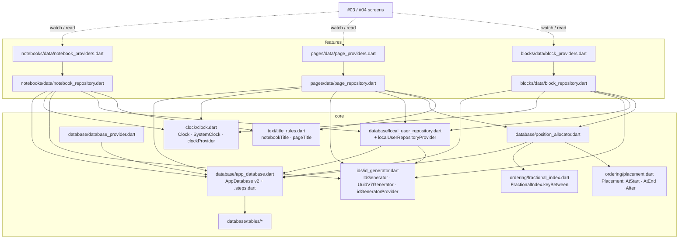
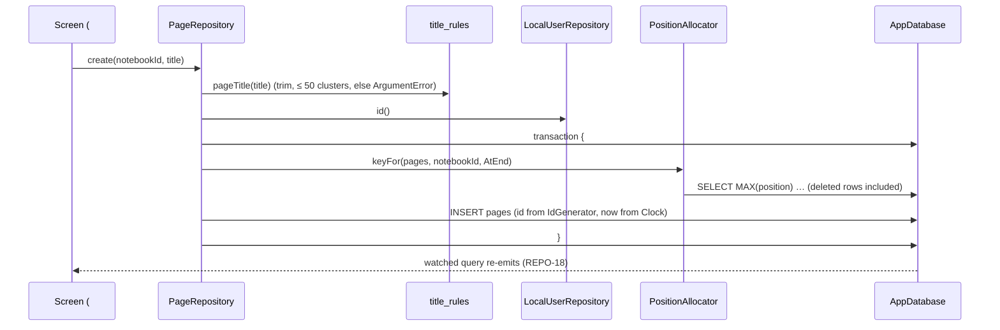

# M02 Local Data Model Design

**Spec**: `.specs/features/m02-local-data-model/spec.md`
**Context**: `.specs/features/m02-local-data-model/context.md`
**Status**: Approved

APIs below were checked with Context7 (Drift `/websites/drift_simonbinder_eu`, Riverpod `/rrousselgit/riverpod/riverpod-v3.0.2`) and against the sources at the versions in `app/pubspec.lock` (`drift` 2.35.2, `drift_dev` 2.35.1, `flutter_riverpod` 3.4.3, `uuid` 4.6.0, `characters` 1.4.1). Points still to confirm while implementing are listed under Risks & Concerns.

---

## Architecture Overview

The building blocks shared across features live in `lib/core/`: tables, the database, the clock, the id generator, the local user, the fractional index and title rules. Each feature gets a `data/` folder with one repository and its providers. #03 and #04 add `presentation/` next to it. Repositories use Drift's query builder directly on `AppDatabase`, without DAOs. `lib/features/` now appears in M02, one milestone earlier than ADR 0018's "Consequences" predicted. The feature-first decision itself doesn't change.



Write path (every write is local and synchronous with SQLite; no network anywhere, RNF-01):



---

## Code Reuse Analysis

### Existing Components to Leverage

| Component | Location | How to Use |
| --- | --- | --- |
| `AppDatabase` (empty, v1) | `app/lib/core/database/app_database.dart` | Gains tables, `schemaVersion` 2 and `migration`; constructor stays `new(super.e)` so tests keep injecting the executor |
| `databaseProvider` | `app/lib/core/database/database_provider.dart` | Unchanged; the base of every new provider |
| `createTestDatabase()` | `app/test/helpers/test_database.dart` | In-memory database for every database test; `beforeOpen` turns foreign keys on there too |
| `NotebookColor`, `CoverPattern` | `app/lib/core/theme/notebook_palette.dart` | `notebooks.color` / `cover` as `textEnum`, storing the enum name (SCHEMA-09) |
| `PreferencesStore` | `app/lib/core/preferences/` | Unchanged; USER-06 test asserts it still holds only `lastOpenedNotebookId` |
| `uuid` 4.6.0 | `pubspec.yaml` | `Uuid().v7()` inside `UuidV7Generator` only |
| STRUCT-03 test | `app/test/app_test.dart:112` | Extended to skip `test/drift/` (generated by `make-migrations`, per `testes.md`) |
| `testes.md` conventions | `app/.claude/docs/testes.md` | `Clock` / `clockProvider` names, `ProviderContainer.test` overrides, `make-migrations` flow |

### Integration Points

| System | Integration Method |
| --- | --- |
| Drift code generation | `build.yaml` gains `databases: app_database: lib/core/database/app_database.dart` and `store_date_time_values_as_text: true`; `build_runner` regenerates `app_database.g.dart` |
| `drift_dev make-migrations` | Run once at v1 (exports the empty v1 schema), again after bumping to v2: writes `drift_schemas/app_database/drift_schema_v{1,2}.json`, `lib/core/database/app_database.steps.dart` and `test/drift/app_database/` |
| Riverpod | Hand-written providers (ADR 0019); tests override only `databaseProvider`, `clockProvider`, `idGeneratorProvider` (REPO-19) |
| #03 / #04 screens | Watch the stream providers and call repository methods via `ref.read(xRepositoryProvider)` |
| Phase 2 (PowerSync) | Tables keep a text `id` PK; `local_user` stays local-only (not synced) |

---

## Components

### Clock — `lib/core/clock/clock.dart`

- **Purpose**: Single source of time, UTC, millisecond precision.
- **Interfaces**:
  - `abstract interface class Clock { DateTime now(); }`
  - `final class SystemClock implements Clock`: `DateTime.now().toUtc()` minus its microseconds (TIME-01, TIME-04)
  - `final clockProvider = Provider<Clock>((ref) => const SystemClock());`
- **Dependencies**: none. The only file in `lib/` allowed to call `DateTime.now()` (TIME-03).
- **Tests**: `test/core/clock/clock_test.dart`: TIME-01, TIME-04 and the TIME-03 scan.

### Id generator — `lib/core/ids/id_generator.dart`

- **Purpose**: Client-side UUID v7 ids (RNF-04).
- **Interfaces**:
  - `abstract interface class IdGenerator { String newId(); }`
  - `final class UuidV7Generator implements IdGenerator`: wraps a `const Uuid()` and returns `v7()`
  - `final idGeneratorProvider = Provider<IdGenerator>((ref) => UuidV7Generator());`
- **Dependencies**: `uuid`. The only file in `lib/` allowed to reference `Uuid` (ID-04).
- **Tests**: `test/core/ids/id_generator_test.dart`: ID-01 (regex `^[0-9a-f]{8}-[0-9a-f]{4}-7[0-9a-f]{3}-[89ab][0-9a-f]{3}-[0-9a-f]{12}$`), ID-02, ID-04 scan.

### Fractional index — `lib/core/ordering/fractional_index.dart`

- **Purpose**: Generate text keys between two keys (POS-02…POS-08).
- **Interfaces**:
  - `abstract final class FractionalIndex { static String keyBetween(String? a, String? b); }`
- **Algorithm**: A port of rocicorp/fractional-indexing (David Greenspan's "Implementing Fractional Indexing"). It uses base-62 digits `0-9A-Za-z`, which are ASCII, so byte order, Dart's `compareTo` and SQLite's `BINARY` collation all agree. A key is a variable-length integer part plus a fraction. The integer's head character `a`–`z` encodes positive lengths and `A`–`Z` negative ones, and the fraction never ends in `0`.
  - `(null, null)` → `a0`; `(a, null)` → increment `a`'s integer, so appending stays short (POS-07); `(null, b)` → decrement `b`'s integer, so prepending stays short; `(a, b)` → midpoint of the fractions (POS-05, POS-06).
  - Throws `ArgumentError` when `a >= b` (POS-08) or when a key is malformed.
- **License**: rocicorp/fractional-indexing is CC0-1.0 (checked with the GitHub API), so the port needs no attribution.
- **Tests**: `test/core/ordering/fractional_index_test.dart`: one test per POS-02…POS-08, including 1,000 repeated inserts before and after.

### Placement — `lib/core/ordering/placement.dart`

- **Purpose**: Say where a page or block goes, without the caller computing keys.
- **Interfaces**: `sealed class Placement`, with `AtStart()`, `AtEnd()` and `After(String id)`.
- **Tests**: none of its own (a plain sealed type); covered through `PositionAllocator`.

### Title rules — `lib/core/text/title_rules.dart`

- **Purpose**: Normalize and validate titles (TITLE-01…TITLE-05).
- **Interfaces**:
  - `const maxTitleLength = 50;`
  - `String notebookTitle(String raw)`: `trim()`, throws `ArgumentError` if empty or longer than 50 grapheme clusters
  - `String pageTitle(String raw)`: `trim()`, throws `ArgumentError` only if longer than 50
- **Dependencies**: `characters` (added to `dependencies`; already resolved at 1.4.1 through Flutter). `raw.trim().characters.length` counts clusters, the same unit as `TextField.maxLength`.
- **Tests**: `test/core/text/title_rules_test.dart`: whitespace trim, empty, exactly 50 with `👍🏽` clusters (accepted), 51 (rejected), following lesson L-002 (exact boundary).

### Tables — `lib/core/database/tables/`

One file per table: `notebooks.dart`, `notebook_members.dart`, `pages.dart`, `blocks.dart`, `local_user.dart`, plus `member_role.dart` (`enum MemberRole { owner, editor, viewer }`). Every table uses `late final` columns (needed for `check` to reference its own column). Full shape under Data Models.

### AppDatabase — `lib/core/database/app_database.dart`

- **Purpose**: Schema v2, migrations, foreign keys.
- **Interfaces**:
  - `@DriftDatabase(tables: [Notebooks, NotebookMembers, Pages, Blocks, LocalUser])`
  - `int get schemaVersion => 2;` (DB-01)
  - `MigrationStrategy get migration`:
    - `onCreate: (m) => m.createAll()` (DB-05)
    - `onUpgrade: stepByStep(from1To2: (m, schema) async { for (final e in schema.entities) await m.create(e); })`: v1 has no tables, so the step creates every v2 table and index (DB-04)
    - `beforeOpen: (_) => customStatement('PRAGMA foreign_keys = ON')` (DB-06)
- **Generated, committed**: `app_database.steps.dart` (by `make-migrations`, not `build_runner`, so `*.g.dart` ignore rules don't apply).
- **Tests**: `test/core/database/app_database_test.dart`. It replaces M01's `TEST-01` (it asserted v1 with no tables) with DB-01, DB-06, SCHEMA-01…SCHEMA-10 (raw `customStatement` inserts to prove the database itself rejects them), TIME-02 and the DEL-03 scan. `test/drift/app_database/migration_test.dart` comes from `make-migrations` and is completed by hand: v1 → v2 `migrateAndValidate` (DB-04), plus a fresh database checked with `validateDatabaseSchema()` from `drift_dev/api/migrations_native.dart` (DB-05).

### Local user — `lib/core/database/local_user_repository.dart`

- **Purpose**: The anonymous author id (ADR 0011, USER-01…USER-04).
- **Interfaces**:
  - `Future<String> id()`: inside a transaction, `INSERT OR IGNORE` the row `(slot: 1, id: ids.newId())`, then select it. The singleton `slot` PK makes concurrent first calls converge on one row (USER-04), even across repository instances. The first `Future` is cached per instance so later calls never touch SQL.
  - `final localUserRepositoryProvider = Provider((ref) => LocalUserRepository(ref.watch(databaseProvider), ref.watch(idGeneratorProvider)));`
- **Tests**: `test/core/database/local_user_repository_test.dart`: USER-02, USER-04 (`Future.wait` on two separate instances), USER-03 with a file-backed `NativeDatabase` in a temp dir, closed and reopened.

### PositionAllocator — `lib/core/database/position_allocator.dart`

- **Purpose**: Turn a `Placement` into a key, looking at **all** sibling rows, deleted ones included (assumption "Keys of deleted rows").
- **Interfaces**:
  - `enum OrderedTable { pages('pages', 'notebook_id'), blocks('blocks', 'page_id') }`: fixed identifiers, never user input
  - `Future<String> keyFor(OrderedTable table, {required String parentId, required Placement at, String? movingId})`
    - `AtEnd`: `keyBetween(MAX(position), null)`
    - `AtStart`: `keyBetween(null, MIN(position))`
    - `After(id)`: reads the anchor's position (throws `ArgumentError` if the anchor is not under `parentId`), then the smallest sibling position strictly greater than it → `keyBetween(anchor, next)`
    - `movingId` is left out of every aggregate, so moving a row never compares against itself.
- **Dependencies**: `AppDatabase` (`customSelect`), `FractionalIndex`, `Placement`. Called inside the repository's transaction.
- **Tests**: `test/core/database/position_allocator_test.dart`: start/end/after, deleted sibling counted, anchor from another parent rejected.

### NotebookRepository — `lib/features/notebooks/data/notebook_repository.dart`

- **Interfaces**:
  - `Future<String> create({required String title, required CoverPattern cover, required NotebookColor color})`: one transaction with the `notebooks` row and the `owner` member row (REPO-01, REPO-02, ADR 0004)
  - `Future<void> update(String id, {String? title, CoverPattern? cover, NotebookColor? color})`: writes only the given fields of that row (REPO-03)
  - `Future<void> archive(String id)` / `unarchive(String id)`: the local user's member row only (REPO-04, REPO-05, ADR 0012)
  - `Future<void> moveToTrash(String id)`: `UPDATE … SET deleted_at = now WHERE id = ? AND deleted_at IS NULL` (DEL-01, DEL-02, DEL-07)
  - `Stream<List<Notebook>> watchActive()` / `watchArchived()`: `notebooks INNER JOIN notebook_members ON notebook_id = notebooks.id AND user_id = <local user>`, filtered on `deleted_at IS NULL` and `archived_at` null / not null, ordered per REPO-06 / REPO-07
- **Providers** (`notebook_providers.dart`): `notebookRepositoryProvider`, `activeNotebooksProvider` and `archivedNotebooksProvider` (`StreamProvider.autoDispose<List<Notebook>>`).

### PageRepository — `lib/features/pages/data/page_repository.dart`

- **Interfaces**:
  - `Future<String> create(String notebookId, {String title = ''})`: `AtEnd` position; a foreign-key failure on a missing notebook propagates (edge case) (REPO-08)
  - `Future<void> rename(String id, String title)`: sets `title`, `updated_at`, `updated_by` (REPO-09)
  - `Future<void> move(String id, Placement to)`: one `UPDATE` of `position`, `updated_at`, `updated_by` (REPO-10, POS-09)
  - `Future<void> moveToTrash(String id)`: same pattern as notebooks
  - `Stream<List<NotebookPage>> watchByNotebook(String notebookId)`: joins `notebooks`, filters `pages.deleted_at IS NULL AND notebooks.deleted_at IS NULL`, ordered by `position`, then `id` (REPO-11, DEL-05, DEL-06)
- **Providers** (`page_providers.dart`): `pageRepositoryProvider`, `pagesProvider` (`StreamProvider.autoDispose.family<List<NotebookPage>, String>`).

### BlockRepository — `lib/features/blocks/data/block_repository.dart`

- **Interfaces**:
  - `Future<String> create(String pageId, {required String type, required String contentJson, Placement at = const AtEnd()})`: `version` left at its default 0 (REPO-13)
  - `Future<void> updateContent(String id, String contentJson)`: never writes `version` (REPO-14, ADR 0013)
  - `Future<void> move(String id, Placement to)`: never writes `version` (REPO-15)
  - `Future<void> moveToTrash(String id)`
  - `Stream<List<Block>> watchByPage(String pageId)`: joins `pages` and `notebooks`, filters all three `deleted_at IS NULL` (REPO-16, DEL-05, DEL-06, DEL-08)
- **Providers** (`block_providers.dart`): `blockRepositoryProvider`, `blocksProvider` (`StreamProvider.autoDispose.family<List<Block>, String>`).

All three repositories follow these rules:

- Every write takes `ids.newId()`, `clock.now()` and `await localUser.id()` (ID-03, USER-05).
- The update companions never include the parent's table (REPO-12, REPO-17).
- No `version` column appears in any companion except through the default on insert.
- Repositories take their dependencies in the constructor. Providers wire them from `databaseProvider`, `clockProvider`, `idGeneratorProvider` and `localUserRepositoryProvider` (REPO-19).

### Invariant scan tests

- **Helper** `test/helpers/lib_scan.dart`: `Iterable<(File, String)> libSources({Set<String> exclude})` yields every `lib/**/*.dart` except generated `*.g.dart`, `*.steps.dart` and `lib/l10n/app_localizations*.dart`.
- **Placement**: each scan sits next to the file it guards, so STRUCT-03 mirroring holds:
  - ID-04 → `id_generator_test.dart`
  - TIME-03 → `clock_test.dart`
  - DEL-03 → `app_database_test.dart`. Scans only files importing `package:drift`, so `HivePreferencesStore`'s `_box.delete` (`hive_preferences_store.dart:17`) is not a false positive. Pattern: `\bdelete(Where|All)?\s*\(` or `DELETE\s+FROM` (case-insensitive).
  - NET-01, NET-02 → `test/app_test.dart`, next to the other STRUCT tests
  - USER-06 → `test/core/preferences/hive_preferences_store_test.dart` (the box's keys after writes are ⊆ `{lastOpenedNotebookId}`)
- **Fakes** in `test/helpers/fakes.dart`: `FakeClock` (settable, millisecond-aligned UTC) and `SequentialIdGenerator` (deterministic valid v7-shaped ids).

### Docs and decisions

- **ADRs** (Portuguese, Contexto/Decisão/Consequências), indexed in `docs/adr/README.md`:
  - 0026 usuário local em tabela Drift
  - 0027 exclusão de caderno derivada para páginas e blocos (answers ADR 0023's first open question)
  - 0028 `blocks.deleted_at` e `notebook_members.id` além do PRD §7
  - 0029 índice fracionário em chaves texto base-62 (own port)
  - 0030 datas como texto ISO-8601 com precisão de milissegundo
  - 0031 versionamento com migrações passo a passo
- **PRD §7**: add `blocks.deleted_at` and `notebook_members.id` citing 0028 (DOC-01).
- **`app/CLAUDE.md` Rules** (DOC-02):
  - `local_user` in Drift
  - deleted notebook hides pages/blocks without writing to them
  - titles trimmed and limited to 50
- **`testes.md` Migrations** (DOC-03): drop "once `AppDatabase` exists" and add that `test/drift/` is exempt from mirroring.

---

## Data Models

The SQL below is what Drift generates with text dates; `datetime` columns are `TEXT` holding `YYYY-MM-DDTHH:MM:SS.mmmZ`.

```sql
CREATE TABLE notebooks (
  id          TEXT NOT NULL PRIMARY KEY,
  title       TEXT NOT NULL,
  cover       TEXT NOT NULL,            -- CoverPattern.name
  color       TEXT NOT NULL,            -- NotebookColor.name
  created_by  TEXT NOT NULL,
  created_at  TEXT NOT NULL,
  deleted_at  TEXT NULL
);

CREATE TABLE notebook_members (
  id          TEXT NOT NULL PRIMARY KEY,
  notebook_id TEXT NOT NULL REFERENCES notebooks (id),
  user_id     TEXT NOT NULL,
  role        TEXT NOT NULL CHECK (role IN ('owner', 'editor', 'viewer')),
  added_by    TEXT NOT NULL,
  created_at  TEXT NOT NULL,
  archived_at TEXT NULL,
  UNIQUE (notebook_id, user_id)
);

CREATE TABLE pages (
  id          TEXT NOT NULL PRIMARY KEY,
  notebook_id TEXT NOT NULL REFERENCES notebooks (id),
  title       TEXT NOT NULL,
  position    TEXT NOT NULL,
  updated_at  TEXT NOT NULL,
  updated_by  TEXT NOT NULL,
  deleted_at  TEXT NULL
);
CREATE INDEX pages_notebook_position ON pages (notebook_id, position);

CREATE TABLE blocks (
  id           TEXT NOT NULL PRIMARY KEY,
  page_id      TEXT NOT NULL REFERENCES pages (id),
  type         TEXT NOT NULL,
  content_json TEXT NOT NULL,
  position     TEXT NOT NULL,
  version      INTEGER NOT NULL DEFAULT 0,
  updated_at   TEXT NOT NULL,
  updated_by   TEXT NOT NULL,
  deleted_at   TEXT NULL
);
CREATE INDEX blocks_page_position ON blocks (page_id, position);

CREATE TABLE local_user (               -- local-only, never synced
  slot INTEGER NOT NULL PRIMARY KEY CHECK (slot = 1),
  id   TEXT NOT NULL
);
```

**Dart row classes** (generated):

- `Notebook`, `NotebookMember`, `Block` and `LocalUserData` keep Drift's default names.
- `Pages` uses `@DataClassName('NotebookPage')`, because Drift's default `Page` clashes with Flutter's `widgets.Page`.

**Relationships**:

- notebook 1—N members (phase 1: exactly one, the owner)
- notebook 1—N pages
- page 1—N blocks

No `ON DELETE` actions, because rows are never physically deleted.

---

## Error Handling Strategy

| Error Scenario | Handling | User Impact |
| --- | --- | --- |
| Invalid title (empty notebook title, > 50 clusters) | `ArgumentError` thrown before the transaction starts; nothing written | #03 sheet validates first; the repository is the last line of defense |
| Parent row missing (page in unknown notebook, block in unknown page) | SQLite FK violation (`SqliteException`) propagates; transaction rolls back | Not reachable from the UI; surfaces as a bug in tests |
| Member insert fails during notebook creation | Same transaction → notebook insert rolled back (REPO-02) | No half-created notebook |
| `After(id)` anchor missing or under another parent | `ArgumentError` from `PositionAllocator` | Bug in the caller; the row does not move |
| `keyBetween` receives `a >= b` (only possible with corrupted or tied keys) | `ArgumentError`; `After` looks for the next key **strictly greater**, so ties never reach it | Row does not move |
| Write to an unknown or already trashed id (`update`, `rename`, `archive`, `moveToTrash`…) | Updates 0 rows, no error | Nothing visible; no screen offers actions on rows it doesn't list |
| Database closed while a stream is listened | Drift closes the stream (done, no error event); provider disposed with the scope | None |
| Stream query error | Stream providers set `retry: (_, _) => null` so errors surface as `AsyncError` instead of looping behind `AsyncLoading` (Riverpod 3 retries by default) | #03 decides how to show it |

---

## Risks & Concerns

| Concern | Location (file:line) | Impact | Mitigation |
| --- | --- | --- | --- |
| STRUCT-03 fails on generated `test/drift/**/*_test.dart` (no `lib/` pair) | `app/test/app_test.dart:112` | CI red right after `make-migrations` | Exempt `test/drift/` in STRUCT-03, in the same task that adds migrations; document in `testes.md` (DOC-03) |
| M01 test asserts v1 with no tables | `app/test/core/database/app_database_test.dart:13` | Fails as soon as tables land | Replaced by the DB-01 test in the schema task |
| Generated `app_database.steps.dart` and `test/drift/**/generated/` may break `very_good_analysis` | `app/analysis_options.yaml:4` | `flutter analyze` red in CI | Add `**/*.steps.dart` and `test/drift/**/generated/**` to `analyzer.exclude` if analyze flags them; check when generating |
| `toIso8601String()` writes microseconds only when non-zero, so text order breaks | `drift-2.35.2/lib/src/runtime/types/mapping.dart:49` | Wrong order in `created_at` / `archived_at` lists | `SystemClock` truncates to ms (TIME-04); `FakeClock` only accepts ms-aligned values |
| `textEnum` breaks reads if an enum value is renamed | `app/lib/core/theme/notebook_palette.dart:4` | Notebooks fail to load | SCHEMA-09 test pins the stored names; renaming becomes a schema migration (noted in ADR 0028) |
| `check()` chained after `textEnum<MemberRole>()` not yet compiled here | `drift-2.35.2/lib/src/dsl/table.dart:157` | Codegen error | Fallback: `text().check(role.isIn(...)).map(EnumNameConverter(MemberRole.values))()`; SCHEMA-05 test catches either |
| Tied positions from two devices (phase 2) | `position_allocator.dart` | `keyBetween(a, a)` would throw | Next sibling is searched with `position > anchor` (strict); ties stay ordered by `id` |
| PowerSync views have no FK/CHECK (phase 2) | — | SCHEMA-05/07 guarantees lost under PowerSync | Already deferred in context.md; ADR 0028 consequences call it out |
| Riverpod 3 auto-retry leaves pending timers in tests | `riverpod-3.4.3/lib/src/core/element.dart` | "A Timer is still pending" | `retry: (_, _) => null` on the stream providers |
| Watching notebook streams requires the local user id first | `notebook_repository.dart` | First emission waits on one `local_user` read | `Stream.fromFuture(localUser.id()).asyncExpand(...)`; id cached after first call |

---

## Tech Decisions (only non-obvious ones)

| Decision | Choice | Rationale |
| --- | --- | --- |
| Data access | Repositories on `AppDatabase` with the query builder, no DAOs | User decision; DAOs would add a layer and generated mixins with no second consumer |
| Row naming | `@DataClassName('NotebookPage')` for `pages` | Avoids clashing with Flutter's `Page` in every screen that imports both |
| Delete method name | `moveToTrash` | Matches the product (ADR 0023) and keeps the DEL-03 scan pattern `\bdelete\(` free of false positives |
| Placement API | `sealed Placement` (`AtStart`, `AtEnd`, `After(id)`) | One shape for create and move of pages and blocks; callers never handle keys |
| Position source | Siblings including deleted rows; next key strictly greater than anchor | Restore in #61 never collides (spec assumption) and ties never reach `keyBetween` |
| Local user concurrency | Singleton `slot` PK + `INSERT OR IGNORE` + per-instance cached future | Correct even across instances and isolates, without app-level locks |
| v1 → v2 step | `m.create` over `schema.entities` | v1 is empty; uses the versioned schema, not the live one, as Drift recommends for step-by-step |
| Stream retry | Disabled on the stream providers | Local SQL errors are not transient; showing them beats a silent loading loop |
| Scan tests location | Next to the guarded file | Keeps STRUCT-03 mirroring without new exemptions |
