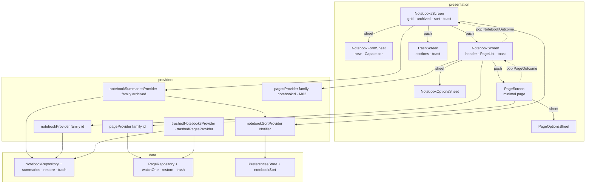
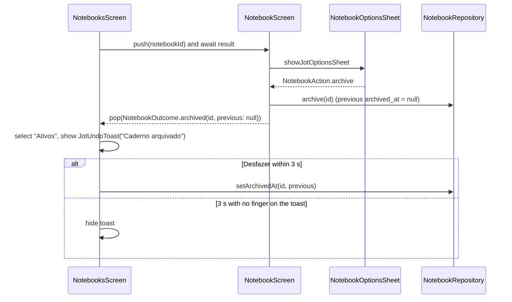

# M03 Notebooks and Pages Design

**Spec**: `.specs/features/m03-notebooks-and-pages/spec.md`
**Context**: `.specs/features/m03-notebooks-and-pages/context.md`
**Status**: Approved (2026-10-12, with the request to create tasks)

APIs below were checked with Context7 (Drift `/websites/drift_simonbinder_eu`, Flutter `/websites/flutter_dev`, intl `/websites/pub_dev_packages_intl`) and against the SDK and packages pinned in the repo: Flutter 3.47.5 (`.fvmrc`), `drift` 2.35.2, `flutter_riverpod` 3.4.3, `intl` 0.20.2, `hive_ce` 2.20.2. The design builds on the M02 code on branch `milestone/m02-local-data-model`, so M03 starts after that branch is merged.

---

## Architecture Overview

Screens live in `lib/features/<feature>/presentation/` and read only Riverpod providers. Writes go through the M02 repositories, which this milestone extends with summaries, single-row watches, restore and trash queries. Navigation is the plain `Navigator` with `MaterialPageRoute`. A screen that closes after an action (archive, delete) pops with a typed outcome, and the screen underneath shows the undo toast. That way every toast belongs to the screen it appears on (TOAST-06).



Archive flow, end to end (ARCH-01, ARCH-03, TOAST-02):



---

## Code Reuse Analysis

### Existing Components to Leverage

| Component | Location | How to Use |
| --- | --- | --- |
| `NotebookRepository` | `app/lib/features/notebooks/data/notebook_repository.dart` | Keeps `create`, `update`, `archive`, `unarchive`, `moveToTrash`. Gains summaries, `watchOne`, `restore` and trash queries |
| `PageRepository` | `app/lib/features/pages/data/page_repository.dart` | `create` (AtEnd, PGLIST-05), `rename`, `move` (REORDER-03), `moveToTrash`, `watchByNotebook`. Gains `watchOne`, `restore` and the trash query |
| `pagesProvider` | `app/lib/features/pages/data/page_providers.dart` | The page list as is |
| `Placement` (`AtStart`, `After`) | `app/lib/core/ordering/placement.dart` | Drop index → placement (REORDER-03) |
| `title_rules.dart` (`maxTitleLength`) | `app/lib/core/text/title_rules.dart` | Field limit 50 and the repository's last check |
| `PreferencesStore` | `app/lib/core/preferences/` | Gains the `notebookSort` key; `lastOpenedNotebookId` written on open (PGLIST-07) |
| `NotebookCoverTile`, `ArchivedNotebookRow`, `PageRow`, `DraggingPageRow` | `app/lib/core/design_system/` | Grid, archived rows, trash notebook rows, page rows, drag proxy |
| `JotTopBar`, `JotFab`, `JotSegmentedControl`, `JotIconButton`, `JotButton` | `app/lib/core/design_system/` | Headers, "Novo caderno" / "Nova página", tabs, header buttons, "Reordenar"/"Concluir" (`.text`), "Desarquivar"/"Restaurar" (`.pill`) |
| `showJotBottomSheet`, `JotBottomSheet` | `app/lib/core/design_system/jot_bottom_sheet.dart` | "Novo caderno" and "Capa e cor" sheets |
| `showConfirmDialog` | `app/lib/core/design_system/confirm_dialog.dart` | NBDEL-01 |
| `NotebookColorPicker`, `NotebookCoverPicker`, `NotebookCover` | `app/lib/core/design_system/` | Form sheet pickers and preview; mini covers in sheets and trash |
| `EmptyState` | `app/lib/core/design_system/empty_state.dart` | Every empty state (see Risks for the canvas size mismatch) |
| `JotTextField` | `app/lib/core/design_system/jot_text_field.dart` | Extended with limit, counter, placeholder and help text |
| Test helpers | `app/test/helpers/` (`createTestDatabase`, `pumpJot`, `FakeClock`, `SequentialIdGenerator`, `StreamRecorder`) | Every widget and database test |
| `intl` 0.20.2 | `pubspec.yaml` | Not used for the date words: its `pt` symbols abbreviate with a dot ("seg.", "out."), and the spec wants "seg", "out" |

### Integration Points

| System | Integration Method |
| --- | --- |
| `JotlineApp` | `home:` becomes `NotebooksScreen` (NBLIST-01); no route table |
| Drift streams | New watched queries join `notebook_members`, `pages` and `notebooks` so they re-emit on any of those tables (NBLIST-07) |
| `hive_ce` | New key `notebookSort` in the same `preferences` box; M01's PREF-05 / USER-06 tests are updated to the two-key set |
| l10n | Every string in `app_pt.arb` with English keys; counts with ICU `plural`, weekday and month abbreviations with ICU `select` |
| M04 | `PageScreen` keeps a body slot below the title; the editor replaces it without touching the header, options or title save |

---

## Components

### Data layer

#### `NotebookSummary` and `NotebookSort` — `lib/features/notebooks/data/notebook_summary.dart`

- **Purpose**: What the list, header and options sheet need about one notebook.
- **Interfaces**:
  - `final class NotebookSummary { Notebook notebook; int pageCount; DateTime lastEditedAt; DateTime? archivedAt; }`. `lastEditedAt` = max `pages.updated_at` of pages not in the trash, else `notebook.createdAt` (SORT-03, EDGE-01).
  - `enum NotebookSort { lastEdited, name, createdAt }`
  - `List<NotebookSummary> sortNotebooks(Iterable<NotebookSummary>, NotebookSort)`: a pure function. `lastEdited` and `createdAt` sort descending with `id` descending as tiebreaker. `name` sorts by `foldForSort(title)`, then `id` ascending (SORT-03…SORT-05).
  - `String foldForSort(String)`: lowercase, with Latin diacritics removed through a fixed map (`á à â ã ä → a`, `ç → c`, …) (SORT-04).
- **Tests**: `notebook_summary_test.dart`: one test per sort option, including "árvore" < "Bloco" < "Caderno" and ties.

#### `NotebookRepository` additions

- `Stream<List<NotebookSummary>> watchSummaries({required bool archived})`:
  - `notebooks` joined with the local user's `notebook_members` row, then `LEFT OUTER JOIN pages ON pages.notebook_id = notebooks.id AND pages.deleted_at IS NULL` with `useColumns: false`.
  - Adds the columns `pages.id.count()` and `pages.updatedAt.max()`, groups by `notebooks.id`, and keeps `notebooks.deleted_at IS NULL` plus the archived filter.
  - Unordered: sorting happens in the provider.
- `Stream<NotebookSummary?> watchOne(String id)`: same query for one id. It emits `null` once the notebook is in the trash, so an open notebook screen can close.
- `Future<void> setArchivedAt(String id, DateTime? value)`: writes `archived_at` on the local user's row. `archive` and `unarchive` delegate to it, and undo uses it to restore the previous value (ARCH-03).
- `Future<void> restore(String id)`: `deleted_at = NULL` (NBDEL-04, TRASH-07).
- `Future<void> putBackInTrash(String id, DateTime deletedAt)`: undo of a restore; writes the original `deleted_at` (TRASH-09).
- `Stream<List<TrashedNotebook>> watchTrashed()`: notebooks with `deleted_at` set, the member's `archived_at`, and the count of pages with `deleted_at IS NULL`. Ordered by `deleted_at` desc, then `id` desc (TRASH-02, TRASH-03, TRASH-11).
- `watchActive()` / `watchArchived()` are removed. Their order tests move to the sort tests; their filter tests are rewritten against `watchSummaries`.

#### `PageRepository` additions

- `Stream<NotebookPage?> watchOne(String id)`: `null` when the page, or its notebook, is in the trash (EDGE-03).
- `Future<void> restore(String id)` and `Future<void> putBackInTrash(String id, DateTime deletedAt)`: same contract as notebooks (PGOPT-05, TRASH-08, TRASH-09).
- `Stream<List<TrashedPage>> watchTrashed()`: pages with `deleted_at` set whose notebook has `deleted_at IS NULL`, joined for the notebook title and color. Ordered by `pages.deleted_at` desc, then `id` desc (TRASH-04, TRASH-05, TRASH-10, TRASH-11).
- `TrashedNotebook` / `TrashedPage` are small final classes next to their repositories.

#### Providers

- **Notebooks** (`notebook_providers.dart`):
  - `notebookSummariesProvider`: `StreamProvider.autoDispose.family<List<NotebookSummary>, bool>`. It watches `notebookSortProvider` and maps the stream through `sortNotebooks`.
  - `notebookProvider`: `.family<NotebookSummary?, String>`.
  - `trashedNotebooksProvider`.
- **Pages** (`page_providers.dart`): `pageProvider` (`.family<NotebookPage?, String>`) and `trashedPagesProvider`.
- **Retry:** every stream provider keeps `retry: (_, _) => null` (M02 convention).

#### Notebook sort preference — `lib/features/notebooks/data/notebook_sort_provider.dart`

- `final notebookSortProvider = NotifierProvider<NotebookSortNotifier, NotebookSort>(NotebookSortNotifier.new)`.
- `build()` reads `preferencesStore.notebookSort`; a null or unknown name yields `NotebookSort.lastEdited` (SORT-06, SORT-07).
- `select(NotebookSort)` sets `state` first, then awaits `setNotebookSort(name)`. That way the lists reorder even when `hive_ce` is unavailable (EDGE-06).
- `PreferencesStore` gains `String? get notebookSort` and `Future<void> setNotebookSort(String)`. `HivePreferencesStore` stores it under `notebookSort`; `UnavailablePreferencesStore` returns `null` and ignores writes.

### Shared text

#### Relative dates — `lib/core/text/relative_dates.dart`

- **Purpose**: DATE-01…DATE-03 in one place.
- **Interfaces**:
  - `final class RelativeDates { new(AppLocalizations l10n, {required DateTime now, DateTime Function(DateTime) toLocal = _deviceLocal}); }`
  - `String day(DateTime utc)`: returns "hoje", "ontem", `weekdayShort`, "d MMM" or "d MMM yyyy". The day difference is computed between local calendar dates, not 24-hour spans.
  - `String withVerb(String verb, DateTime utc)`: "arquivado hoje" / "criado em 2 out" (DATE-02).
  - `String withTime(String verb, DateTime utc)`: "Editada hoje, 14:32" / "Editada em 2 out, 14:32".
- **Words**: from l10n:
  - `weekdayShort` (`select` over `1`…`7`) → "seg"…"dom"
  - `monthShort` (`select` over `1`…`12`) → "jan"…"dez"
  - `today`, `yesterday`, `onDate` ("em {date}")
- **Clock**: `now` comes from `clockProvider`, so tests are deterministic. `toLocal` is injectable, so DATE-03 is tested with a fixed −03:00 offset.
- **Page counts**: `pageCount` ICU plural in the ARB: `{count, plural, =0{nenhuma página} =1{1 página} other{{count} páginas}}` (DATE-04). No code.

### Design system additions (`lib/core/design_system/`, one widget per file, each with its test)

| Widget | File | Built from | Notes |
| --- | --- | --- | --- |
| `JotTextField` (extended) | `jot_text_field.dart` | Canvas "Campo", "Novo caderno: nome perto do limite" | New optional params: `maxLength`, `counterFrom` (shows "N/50" right of the label; danger color at the limit), `hintText`, `helperText`, `autofocus`, `focusNode`. Uses `MaxLengthEnforcement.enforced`, which counts grapheme clusters like `title_rules` (NBNEW-04, EDGE-07). Hides the built-in counter |
| `JotUndoToast` | `jot_undo_toast.dart` | Toast in "Página excluída: desfazer" | `JotUndoToast({required String message, required VoidCallback onUndo, required VoidCallback onTimeout})`. Owns a 3 s `Timer`. A `Listener` cancels it on pointer down and restarts it at 3 s on pointer up or cancel (TOAST-02, TOAST-03). `static const duration = Duration(seconds: 3)`. Exposed as `role: status` through `Semantics(liveRegion: true)` |
| `JotOptionsSheet` + `JotOptionRow` | `jot_options_sheet.dart` | "Opções do caderno", "Opções da página", "Ordenar cadernos" | `showJotOptionsSheet<T>(context, {required Widget header, required List<List<JotOptionRow<T>>> groups})` resolves to the tapped row's value. `JotOptionRow<T>({icon, label, subtitle, value, destructive, checked})`. Groups render as white cards with dividers; a `destructive` row uses `danger`. The sort sheet uses `checked` rows with the check icon and `Semantics(inMutuallyExclusiveGroup)` (SORT-01) |
| `JotTextInputDialog` | `jot_text_input_dialog.dart` | "Renomear caderno", "Renomear página" | `showTextInputDialog(context, {title, label, initialValue, hintText, helperText, required bool allowEmpty})` → `Future<String?>`. Same frame as `ConfirmDialog`. "Salvar" is disabled while `!allowEmpty && text.trim().isEmpty` (NBOPT-04). Limit 50, counter from 40 |
| `JotBadge` | `jot_badge.dart` | "Arquivado" in "Caderno arquivado aberto" | Text on `bgTrilho`, `inkCorpo`, radius `rBloco`… per canvas |
| `JotIconGlyph` (extended) | `icons/jot_icon.dart` | SVGs in the new artboards | New glyphs: `edit`, `cover`, `archive`, `unarchive`, `check`, `page`, `notebook` |

`design.md` (`app/.claude/docs`) gains one row per new widget in the same commit (DOC-02).

### Screens

#### `NotebooksScreen` — `lib/features/notebooks/presentation/notebooks_screen.dart`

- **Watches**:
  - `notebookSummariesProvider(false)` and `(true)`
  - `notebookSortProvider`
- **Owns**: the selected tab and the current `UndoToastRequest?` (message + undo callback).
- **Builds**:
  - **Header:** `JotTopBar.root` ("Cadernos"), actions "Ordenar" and "Lixeira". "Buscar" is left out (NBLIST-10), and "Ordenar" hides when there are no notebooks (NBLIST-05).
  - **Tabs:** `JotSegmentedControl` with the counts (NBLIST-02).
  - **Body:** grid of `NotebookCoverTile`; the archived explanation plus `ArchivedNotebookRow`s; or an `EmptyState`.
  - **Overlays:** `JotFab` "Novo caderno" and the `JotUndoToast` in a bottom `Stack`, 108 above the FAB baseline (canvas).
- **Navigation**:
  - "Novo caderno" opens `NotebookFormSheet.create`; on success it pushes `NotebookScreen` (NBNEW-06).
  - A tile or row pushes `NotebookScreen` and awaits a `NotebookOutcome` (`archived`, `unarchived`, `trashed`). The screen then shows the matching toast and switches to "Ativos" (ARCH-01, ARCH-02, NBDEL-02).
  - "Desarquivar" on a row calls `setArchivedAt(id, null)` and shows the toast with the previous value (ARCH-02, ARCH-03).
  - The "Lixeira" button pushes `TrashScreen` (NBLIST-09).
  - "Ordenar" opens `NotebookSortSheet` (SORT-01, SORT-02).
- **Metas**: built with `RelativeDates`:
  - active tile: "`pageCount` · `day(lastEditedAt)`"
  - archived row: "`pageCount` · `withVerb('arquivado', archivedAt)`"

#### `NotebookFormSheet` — `lib/features/notebooks/presentation/notebook_form_sheet.dart`

- `Future<String?> showNewNotebookSheet(context)`:
  - "Novo caderno" sheet with `JotTextField(maxLength: 50, counterFrom: 40, hintText: 'Nome do caderno', autofocus: true)`.
  - Defaults `azulTinta` + `lisa`; the preview shows the typed name.
  - "Criar caderno" is disabled while the trimmed name is empty.
  - Returns the new id (NBNEW-01…NBNEW-07).
- `Future<bool> showCoverSheet(context, NotebookSummary)`:
  - The same sheet titled "Capa e cor", without the name field, current values selected.
  - Its "Salvar" button calls `update(id, cover:, color:)` (NBOPT-07, NBOPT-08).

#### `NotebookScreen` — `lib/features/notebooks/presentation/notebook_screen.dart`

- **On open**: writes `lastOpenedNotebookId` in `initState` (PGLIST-07).
- **Watches**: `notebookProvider(id)` and `pagesProvider(id)`. If `notebookProvider` emits `null` (the notebook went to the trash), the screen pops.
- **Header**:
  - `JotTopBar.back(previousLabel: 'Cadernos')`, actions "Reordenar"/"Concluir" and ⋯.
  - Below the bar: mini `NotebookCover`, title, `pageCount`, and a `JotBadge` "Arquivado" when archived (PGLIST-01, PGLIST-04).
- **Body**: `PageList` (below), the empty state (PGLIST-03), `JotFab` "Nova página" hidden in reorder mode (REORDER-01), and the `JotUndoToast`.
- **"Nova página"**: `create(id)`, then pushes `PageScreen(autofocusTitle: true)` (PGLIST-05).
- **⋯**: `NotebookOptionsSheet`. Its action:
  - **rename:** `showTextInputDialog`, then `update(title:)`.
  - **cover:** `showCoverSheet`.
  - **archive / unarchive:** writes, then pops with the outcome.
  - **delete:** `showConfirmDialog`, then `moveToTrash`, then pops `trashed`.
- **Page outcome**: awaits `PageOutcome.trashed(pageId)` from `PageScreen` and shows "Página movida para a lixeira", whose undo calls `restore` (PGOPT-04, PGOPT-05).

#### `PageList` — `lib/features/pages/presentation/page_list.dart`

- **Widget**: `ReorderableListView.builder` with `buildDefaultDragHandles: false` and `onReorderItem`, since `onReorder` is deprecated in Flutter 3.47.
- **Reorder mode**: each row shows a handle wrapped in `ReorderableDragStartListener` with the semantics label `moveItem(title)`. `proxyDecorator` returns `DraggingPageRow` (REORDER-01, REORDER-02).
- **Drop**: `onReorderItem(old, new)` does nothing when `old == new` (REORDER-04). Otherwise it computes the placement on the list without the moved item (`AtStart` when `new == 0`, else `After(list[new - 1].id)`) and calls `move`.
- **Optimistic order**: the widget keeps its own copy of the list during the drop, until the stream re-emits, so the row does not jump back for one frame.
- **Rows**: `PageRow(title: title.isEmpty ? l10n.untitled : title, muted: title.isEmpty, date: day(updatedAt), excerpt: null)`. `PageRow` gains a `muted` flag for "Sem título" (PGLIST-02).

#### `PageScreen` — `lib/features/pages/presentation/page_screen.dart`

- **Watches**: `pageProvider(id)` and `notebookProvider(notebookId)` (back label = notebook title). A `null` page pops the screen (EDGE-03).
- **Title field**: `PageTitleField`, a private widget with the `tituloPagina` style, the `accentWash` fill and an `accent` underline while focused. It has the "Sem título" placeholder, limit 50 and counter from 40 (PAGE-01, PAGE-05).
- **Save**:
  - A 500 ms `Timer` debounce calls `rename` (PAGE-03).
  - A `flush()` runs from `PopScope.onPopInvokedWithResult` and from `AppLifecycleListener(onHide:, onPause:)` (PAGE-04).
  - `flush()` is a no-op when the field text equals the last saved value.
- **"Editada" line**: `withTime('Editada', updatedAt)` (PAGE-01, PAGE-06).
- **Body**: empty (PAGE-02).
- **⋯**: `PageOptionsSheet`:
  - **rename:** `showTextInputDialog(allowEmpty: true, helperText: …)`, then `rename` (PGOPT-02, PGOPT-03).
  - **delete:** flushes, calls `moveToTrash`, then pops `PageOutcome.trashed` (PGOPT-04).

#### `TrashScreen` — `lib/features/trash/presentation/trash_screen.dart`

- **Watches**: `trashedNotebooksProvider` and `trashedPagesProvider`.
- **Builds**: the "Cadernos" section with `ArchivedNotebookRow(actionLabel: 'Restaurar')`, the "Páginas" section with a new private `_TrashedPageRow` (title, color chip, notebook title, date, pill button), or the `EmptyState` (TRASH-01…TRASH-06).
- **Restore**: calls `restore` and shows a toast whose undo calls `putBackInTrash(id, original deletedAt)` (TRASH-07…TRASH-09).
- **Location**: `lib/features/trash/` holds only presentation. The data stays in the notebooks and pages repositories, which own those tables.

### Outcomes — `lib/features/notebooks/presentation/notebook_outcome.dart`, `lib/features/pages/presentation/page_outcome.dart`

`sealed class NotebookOutcome` with `Archived(id, previous)`, `Unarchived(id, previous)` and `Trashed(id)`. `sealed class PageOutcome` has `Trashed(id)`. They are typed pop results, so a toast is always raised by the screen that ends up visible.

### E2E — `app/integration_test/`

- **Flow files**:
  - `notebooks_flow_test.dart`: create, rename, archive, delete
  - `pages_flow_test.dart`: create, reorder
  - `trash_flow_test.dart`: delete a page and a notebook, restore both
- **Setup**: each flow pumps `JotlineApp` with an in-memory database override and a fresh `UnavailablePreferencesStore`.
- **No network (E2E-02)**: `setUpAll` installs `HttpOverrides.global` with a client whose every call throws, so any network attempt fails the test even with the emulator online.

---

## Data Models

No schema change: M03 reads and writes the v2 tables. The aggregate behind `watchSummaries`, as Drift will generate it:

```sql
SELECT notebooks.*, notebook_members.archived_at,
       COUNT(pages.id)        AS page_count,
       MAX(pages.updated_at)  AS last_page_edit
FROM notebooks
INNER JOIN notebook_members
        ON notebook_members.notebook_id = notebooks.id
       AND notebook_members.user_id = :localUser
LEFT OUTER JOIN pages
        ON pages.notebook_id = notebooks.id
       AND pages.deleted_at IS NULL
WHERE notebooks.deleted_at IS NULL
  AND notebook_members.archived_at IS [NOT] NULL
GROUP BY notebooks.id;
```

`MAX` over ISO-8601 text works because every stored date has the same length (M02 TIME-04, ADR 0030). `last_page_edit` is read as `DateTime` through the column's type converter, and `null` falls back to `created_at`.

```dart
final class NotebookSummary {
  const NotebookSummary({required this.notebook, required this.pageCount, required this.lastEditedAt, this.archivedAt});
  final Notebook notebook;
  final int pageCount;
  final DateTime lastEditedAt;
  final DateTime? archivedAt;
}

final class TrashedNotebook {
  final Notebook notebook;     // deletedAt non-null
  final int pageCount;         // pages with deleted_at IS NULL
  final DateTime? archivedAt;
}

final class TrashedPage {
  final NotebookPage page;     // deletedAt non-null
  final String notebookTitle;
  final NotebookColor notebookColor;
}
```

Preferences box keys after M03: `lastOpenedNotebookId`, `notebookSort` (value: `NotebookSort.name`).

---

## Error Handling Strategy

| Error Scenario | Handling | User Impact |
| --- | --- | --- |
| Title over 50 or empty notebook name | Fields block it (`maxLength`, disabled button); the repository `ArgumentError` stays as the last line | None |
| Stream provider in `AsyncError` (local SQL error) | Screen shows nothing in that region and logs with `dart:developer` `log(name: 'jotline.ui')`; no retry | Blank list instead of a crash; the canvas has no error state (see Risks) |
| Notebook trashed or page trashed while open | `watchOne` emits `null` → screen pops | Returns to the parent list |
| Undo after the row changed elsewhere | Undo writes are idempotent `UPDATE … WHERE id = ?`; a missing row updates 0 rows | Nothing |
| Preferences box unavailable | `UnavailablePreferencesStore`; sort lives in the notifier state for the session | Sort works until restart, then defaults (EDGE-06) |
| Title debounce pending when the app is killed | Lost only for the last < 500 ms if the OS kills the process before `onHide`/`onPause` | At most a few characters; acceptable for a title (PAGE-04 covers back and background) |

---

## Risks & Concerns

| Concern | Location (file:line) | Impact | Mitigation |
| --- | --- | --- | --- |
| PREF-05 and USER-06 tests pin the box to `{lastOpenedNotebookId}` | `app/test/core/preferences/hive_preferences_store_test.dart:53` | Red as soon as `notebookSort` is written | Update both tests to the two-key set in the sort task; the sort ADR records the change to M01's PREF-05 |
| `watchActive`/`watchArchived` used by M02 tests | `app/test/features/notebooks/data/notebook_repository_test.dart:37`, `app/test/features/blocks/data/block_repository_test.dart:256` | Removing them breaks M02 tests | Migrate those assertions to `watchSummaries` in the same task |
| `intl` `pt` symbols end abbreviations with a dot | `intl-0.20.2/lib/date_symbol_data_local.dart:14350` | "seg." / "out." instead of "seg" / "out" | Weekday and month words come from ARB `select` keys |
| Canvas empty states use three sizes (56/1.2/19 px, 48/1.3/17 px, 40/1.4/16 px), while the "Estado vazio" component is fixed at 40/1.4/16 | Canvas "Cadernos: primeira abertura", "Caderno sem páginas", "Componentes" | Screens differ from the component, or the component grows variants | Decided (user, 2026-10-12): `EmptyState` as is everywhere (40/1.4/16) |
| Canvas minimal page shows "Editada agora" after typing | Canvas "Página mínima, sem editor (M03)" | Differs from PAGE-06 ("Editada hoje, HH:mm") | Spec wins (confirmed); no "agora" string |
| Canvas sort sheet draws a translucent ink scrim; other sheets draw `bgVeu` | Canvas "Ordenar cadernos" vs "Opções do caderno" | Two scrims for the same component | All sheets use the `JotBottomSheet` barrier (`bgVeu`); noted for the canvas |
| No error state in the canvas | — | A failing stream shows a blank area | Logged; revisit if it ever happens in internal use |
| `ReorderableListView.onReorder` deprecated in Flutter 3.47 | `fvm/versions/3.47.5/packages/flutter/lib/src/material/reorderable_list.dart:82` | Lint warnings, wrong index math | Use `onReorderItem` (index already adjusted) |
| Stream re-emit after a move arrives one frame later | `page_list.dart` | Row flickers back before the new order | Local optimistic copy of the list until the next emission |
| Toast `Timer` left running in widget tests | `jot_undo_toast.dart` | "A Timer is still pending" | Cancel in `dispose`; tests pump past 3 s or unmount |
| `PageScreen` save on pop while the notebook screen awaits the outcome | `page_screen.dart` | Lost last characters, or a write after the page is trashed | `flush()` awaited before `moveToTrash` and before pop; `rename` on a trashed id updates 0 rows anyway |
| Large page lists (RNF-06) | `PageList` | Jank with 10k pages | `ReorderableListView.builder` is lazy; the load test stays in #27 |
| Values in the new artboards not in the token tables (toast padding, badge padding, empty state sizes) | Canvas phase 1 boards | Literal values outside `lib/core/theme/` would break THEME-09 | Map to existing `JotSpace`/`JotRadius` tokens; any missing value is added as a token in the theme first (lesson L-004) |

---

## Tech Decisions (only non-obvious ones)

| Decision | Choice | Rationale |
| --- | --- | --- |
| Navigation | `Navigator` + `MaterialPageRoute`, typed pop results; no router package | Four screens, no deep links in phase 1; no new dependency. A router can come with phase 2 auth if needed |
| Undo toast | Own `JotUndoToast` inside each screen's `Stack`, not `ScaffoldMessenger` `SnackBar` | `SnackBar` survives route changes (breaks TOAST-06), has no hold-to-pause and does not match the canvas toast |
| Toast after a screen closes | The closing screen pops a typed outcome; the screen underneath shows the toast | The toast is always on the visible screen, and leaving it dismisses it without undo |
| Notebook aggregates | SQL `COUNT`/`MAX` with `LEFT JOIN` + `GROUP BY` in one watched query | One stream per tab, re-emits on page changes; no N+1 |
| Notebook sorting | In Dart (`sortNotebooks`), after the query | Accent-insensitive order needs folding that SQLite `NOCASE` does not do; notebook counts are small |
| Undo writes | `setArchivedAt(id, previous)` and `putBackInTrash(id, deletedAt)` | Undo restores the exact previous value instead of stamping a new date |
| Date words | ARB `select` keys, own formatter | `intl` `pt` abbreviations carry a trailing dot |
| Trash feature folder | `lib/features/trash/presentation/` only | The screen is its own feature; the data belongs to the tables' repositories |
| Remove `watchActive`/`watchArchived` | Replaced by `watchSummaries(archived:)` | No dead API; the M02 behavior they tested moves to the new tests |
