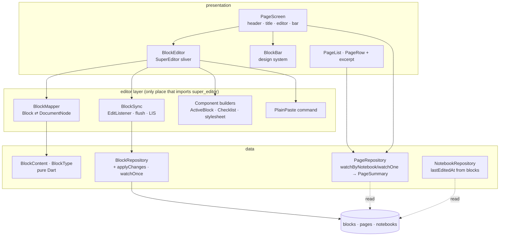

# M04 Block Editor Design

**Spec**: `.specs/features/m04-block-editor/spec.md`
**Context**: `.specs/features/m04-block-editor/context.md`
**Status**: Approved (2026-10-15, with the request to create tasks)

APIs below were checked against the super_editor docs on Context7 (`/flutter-bounty-hunters/super_editor`), against the `super_editor 0.3.0-dev.52` source in the pub cache, and against the `super_editor` prototype on branch `spike/22-block-editor` (`spikes/m04-editor/super_editor/`, 26 tests). Pinned versions: Flutter 3.47.5 (`.fvmrc`), `drift` 2.35.2, `sqlite3` 3.5.2, `flutter_riverpod` 3.4.3. SPIKE-01 to SPIKE-11 are already done (ADR 0035, accepted). This design covers #23 and #24.

---

## Architecture Overview

The page screen becomes one `CustomScrollView`. The M03 header and title stay as box slivers. Below them, `SuperEditor` runs as a sliver (the library's recommended embedding). Below the editor, a filler sliver catches taps on the empty area. The block bar sits under the scroll view, in the same `Column`, so `Scaffold` keyboard insets dock it above the keyboard.

The editor document is loaded once from `blocks` when the page opens. From then on the editor is the source of truth while the screen is open. Phase 1 has a single writer, so the screen does not re-read blocks from the stream. `BlockSync` listens to the editor's change log, collects the touched node ids, and on each flush writes only those rows in one transaction.

Only `lib/features/blocks/presentation/editor/` imports `package:super_editor`. A `lib_scan` test enforces it. The rest of the app sees `blocks` rows and `BlockContent`.



Typing to row, end to end (SAVE-02, SAVE-06, SAVE-12):

```mermaid
sequenceDiagram
    participant U as User
    participant E as Editor (super_editor)
    participant S as BlockSync
    participant R as BlockRepository
    U->>E: Enter in the middle of block A
    E-->>S: DocumentEdit(NodeChangeEvent A, NodeInsertedEvent n1)
    S->>S: touched = {A, n1}; restart 500 ms timer
    Note over S: 500 ms with no edit, page exit, or app inactive/hidden/paused
    S->>S: build changes in document order:<br/>Update(A), Insert(n1, after: A)
    S->>R: applyChanges(pageId, changes)  (one transaction, not awaited by any frame)
    R-->>S: {n1: newBlockId}
    S->>S: nodeId n1 → block id
```

---

## Code Reuse Analysis

### Existing Components to Leverage

| Component | Location | How to Use |
| --- | --- | --- |
| `BlockRepository` | `app/lib/features/blocks/data/block_repository.dart` | Keeps `create`, `move`, `moveToTrash` and `watchByPage`. Gains `applyChanges` (atomic flush) and a one-shot `loadPage`. `updateContent` is replaced by the `Update` change, which also writes `type` (BAR-05, ADR 0035) |
| `PositionAllocator` + `Placement` (`AtStart`, `AtEnd`, `After`) | `app/lib/core/database/position_allocator.dart`, `app/lib/core/ordering/placement.dart` | Insert after the previous persisted block (SAVE-06); one move per drag (BMOVE-02) |
| Spike `BlockMapper`, `BlockContent`, `normalizeMarks`, `BlockSync` (LIS reorder, `_previousPersisted`) | `spike/22-block-editor:spikes/m04-editor/super_editor/lib/` | Ported, not merged: rewritten against Drift, `IdGenerator` and the app's lints, with their tests (SPIKE-11) |
| Spike `ActiveBlockBuilder`, `MutedTaskComponentBuilder`, stylesheet | `spike/…/super_editor/lib/editor_page.dart` | Starting point for the in-edit wrapper and stylesheet; colors and fonts come from the theme tokens, never literals |
| `PageScreen` save pattern (500 ms `Timer`, `PopScope`, `AppLifecycleListener`) | `app/lib/features/pages/presentation/page_screen.dart:41-80` | Same pattern for blocks; one `_flushAll()` flushes the title and the blocks |
| `RelativeDates.withTime` / `.day` | `app/lib/core/text/relative_dates.dart` | Same formatting, fed with `lastEditedAt` instead of `updatedAt` |
| `PageRow(excerpt:)` | `app/lib/core/design_system/page_row.dart` | Already draws the excerpt in `itemTrecho`, one line with ellipsis (EXCERPT-02) |
| `JotIcon` (`heading`, `checklist`, `dragHandle`) | `app/lib/core/design_system/icons/jot_icon.dart` | Bar and handle glyphs; `text` and `list` are added |
| Theme tokens `blocoTexto`, `blocoTitulo`, `accentWash`, `accentSoft`, `accentPress`, `inkFeito`, `bgMesa`, `bgTrilho`, `rBloco`, `rCampo`, `shadow.erguido` | `app/lib/core/theme/` | Every editor and bar value (THEME-09) |
| `libSources()` | `app/test/helpers/lib_scan.dart` | Import-boundary test for `super_editor` |
| Test helpers (`createTestDatabase`, `pumpJot`, `FakeClock`, `SequentialIdGenerator`, `StreamRecorder`), e2e `no_network.dart`, `flows.dart` | `app/test/helpers/`, `app/integration_test/helpers/` | Every new test; E2E-02 reuses the throwing `HttpOverrides` |
| `launch_to_new_page_test.dart` | `app/integration_test/perf/` | PERF-01 extended until the editor is rendered and the title is focused |

### Integration Points

| System | Integration Method |
| --- | --- |
| `pubspec.yaml` | `super_editor: 0.3.0-dev.52`, exact (ADR 0035) |
| Android build | `compileSdk = 36` in `android/app/build.gradle.kts`, needed by `super_keyboard 0.4.1` (ADR 0035) |
| Drift | No schema change. New watched queries use `customSelect(..., readsFrom: {pages, blocks, notebooks})`, so they re-emit on block writes (EDITED-04, EXCERPT-05) |
| SQLite JSON | `json_extract(content_json, '$.text')` for the excerpt. JSON functions are built into SQLite ≥ 3.38: the `sqlite3` 3.5.2 package bundles a newer one, and the test host has 3.46.1 |
| l10n | New keys: `blockTypeText` "Texto", `blockTypeHeading` "Título", `blockTypeList` "Lista", `blockTypeChecklist` "Checklist", `markBold` "Negrito", `markItalic` "Itálico", `moveBlock` "Mover bloco", `blockBarLabel` "Tipo de bloco e formatação" |
| M05 search (#26) | Reads `BlockContent.text` from `content_json` with no editor import |
| M05 drawing (#25) | A new `BlockType` value plus one more component builder in the editor layer |

---

## Components

### Data layer

#### `BlockType`, `Mark`, `BlockContent`: `lib/features/blocks/data/block_content.dart`

- **Purpose**: Our own `content_json` format and the persisted type identifiers, with no editor dependency (SAVE-10). Fixed by the block model ADR (0036).
- **Interfaces**:
  - `enum BlockType { text('text'), heading('heading'), bulletedListItem('bulleted_list_item'), checklistItem('checklist_item'); final String id; static BlockType fromId(String) }`. An unknown id reads as `text`.
  - `enum MarkType { bold('bold'), italic('italic') }`.
  - `final class Mark { int start; int end; MarkType type; }`: UTF-16 offsets, `end` exclusive.
  - `final class BlockContent { String text; List<Mark> marks; bool? checked; factory fromJson(String); String toJson(); }`.
    - Marks are normalized on read and write: sorted, with overlapping or adjacent ranges of the same type merged, and empty ranges dropped.
    - `checked` is written only when non-null.
  - `BlockContent forType(BlockType)`: drops `checked` for any type other than `checklistItem` and defaults it to `false` for one (BAR-06).
- **JSON shape**: `{"text":"Belém cedo","marks":[{"start":0,"end":5,"type":"bold"}],"checked":false}`.
- **Tests**: `block_content_test.dart`. Round-trip with overlapping bold+italic, accents, a flag emoji and empty text; `checked` only on checklist items; unknown type and unknown mark (ignored).

#### `BlockRepository` changes

- `Future<List<Block>> loadPage(String pageId)`: one-shot read with the same filter and order as `watchByPage` (EDIT-01).
- `Future<Map<String, String>> applyChanges(String pageId, List<BlockChange> changes)`:
  - Runs every change in one `transaction`, in list order, and returns the new block id for each `Insert.key`.
  - `sealed class BlockChange`:
    - `Insert(key, type, contentJson, Placement at)`: `at` is `After(id)` or `AtStart()`, resolved inside the same transaction, so an `After` can point to an id inserted earlier in the batch.
    - `Update(id, type, contentJson)`
    - `Trash(id)`
    - `Move(id, Placement)`
  - Every write sets `updated_at = clock.now()` and `updated_by = localUser`, and never sets `version` (SAVE-04, ADR 0013). `Trash` writes only `deleted_at`, as `moveToTrash` does today.
  - `Update` with the same `type` and `content_json` as the stored row writes nothing (SAVE-05).
- `updateContent` is removed. Its M02 tests move to `Update`.
- **Tests**: `block_repository_test.dart` gains:
  - one transaction per batch (a failing change rolls back the batch);
  - an `After` that points to an insert of the same batch;
  - no-op update;
  - `version` unchanged;
  - the `pages` row byte-identical after any batch (SAVE-05, REPO-17).

#### `PageSummary` and the page queries: `lib/features/pages/data/page_summary.dart`, `page_repository.dart`

- `final class PageSummary { NotebookPage page; DateTime lastEditedAt; String? excerpt; }`
- **`lastEditedAt`** (EDITED-01): `max(pages.updated_at, max(blocks.updated_at), max(blocks.deleted_at))` over every block of the page, deleted ones included. SQLite's scalar `max()` returns `NULL` when any argument is `NULL`, so each block aggregate is wrapped in `COALESCE(…, pages.updated_at)`. Text comparison is valid because every date has the same ISO-8601 length (ADR 0030).
- **`excerpt`** (EXCERPT-01, EXCERPT-04):
  - a correlated subquery that takes `json_extract(content_json, '$.text')` from the first block with `deleted_at IS NULL`, `type IN ('text','bulleted_list_item','checklist_item')` and `trim(json_extract(...), ' \t\n\r') <> ''`, ordered by `position, id`, with `LIMIT 1`;
  - Dart trims the result and maps an empty one to `null` (EXCERPT-03, EDGE-07);
  - the `blocks_page_position` index covers the lookup.
- `watchByNotebook(notebookId)` → `Stream<List<PageSummary>>` and `watchOne(id)` → `Stream<PageSummary?>`: one `customSelect` with `readsFrom: {pages, blocks, notebooks}`. Order stays `position, id` (EDITED-05).
- `pagesProvider` and `pageProvider` change type accordingly. `PageScreen`, `PageOptionsSheet` and `PageList` read `.page` and `.lastEditedAt`.
- **Tests**: `page_repository_test.dart`:
  - page edited yesterday + block saved today → today, `pages` row unchanged;
  - a deleted block's `deleted_at` counts;
  - excerpt skips the heading, an empty block, a whitespace-only block and a deleted block;
  - no qualifying block → `null`;
  - the stream re-emits on a block write.

#### `NotebookRepository._watchSummaries` change (EDITED-03)

- Adds `LEFT OUTER JOIN blocks ON blocks.page_id = pages.id`, with no `deleted_at` filter (EDITED-01).
- `pageCount` becomes `COUNT(DISTINCT pages.id)`, because the join repeats page rows.
- `lastEditedAt` = the max of `MAX(pages.updated_at)`, `MAX(blocks.updated_at)` and `MAX(blocks.deleted_at)`, falling back to `created_at`.
- Pages in the trash stay out through the existing join condition. Their blocks stay out with them.
- **Tests**: a notebook whose only change is a block write today sorts first under "Editados recentemente"; counts unchanged with many blocks.

### Editor layer: `lib/features/blocks/presentation/editor/` (the only `super_editor` importer)

#### `BlockMapper`: `block_mapper.dart`

- **Purpose**: Row ⇄ node, ported from the spike (SPIKE-02, SPIKE-04).
- **Interfaces**:
  - `MutableDocument toDocument(List<Block> rows)`: loaded nodes use the block id as node id. An empty list yields one empty `ParagraphNode` with an editor-generated id, which is not persisted (EDIT-04, EDIT-05).
  - `DocumentNode toNode(BlockType, BlockContent, {required String id})`:
    - `text` → `ParagraphNode`;
    - `heading` → `ParagraphNode` with `blockType: header1Attribution`;
    - `bulletedListItem` → `ListItemNode.unordered`;
    - `checklistItem` → `TaskNode(isComplete:)`.
  - `(BlockType, BlockContent) fromNode(DocumentNode)`:
    - the reverse mapping;
    - any other node or block type maps to `text`;
    - `ListItemNode` and `TaskNode` indent is dropped (nested lists are out of scope);
    - only bold and italic attributions are kept;
    - inclusive spans convert to exclusive ends.
- **Tests**: `block_mapper_test.dart`. Spike cases plus header round trip, an indent dropped, and a link attribution dropped.

#### `BlockSync`: `block_sync.dart`

- **Purpose**: Turn the editor change log into `BlockChange` batches (SPIKE-03, SAVE-01…SAVE-09).
- **Interfaces**:
  - `BlockSync({required Editor editor, required String pageId, required BlockRepository repository, required Iterable<String> loadedIds, Duration delay = const Duration(milliseconds: 500)})`
  - `Future<void> flush()`: cancels the timer and writes the pending changes. Flushes are serialized on a `Future` chain, so a batch never starts before the previous one returned its new ids. Callers never `await` it on a frame path (SAVE-12).
  - `void dispose()`
  - `@visibleForTesting Set<String> get pendingNodeIds`
- **Behavior**:
  - `FunctionalEditListener` adds the `nodeId` of every `NodeDocumentChange` to `touched`, sets `moved` on `NodeMovedEvent`, and restarts the timer.
  - On flush, `touched` is walked **in document order**, so each insert's `After` already exists, followed by the missing ids:
    - **Node present, block id known** → `Update`.
    - **Node present, no block id, text empty** → deferred. It stays in `touched` and is not written (EDIT-05, any type: Q1).
    - **Node present, no block id, text non-empty** → `Insert(key: nodeId, at: After(previous persisted block) or AtStart)` (SAVE-06).
    - **Node missing, block id known** → `Trash` (SAVE-07, SAVE-08). The merged-into block is an `Update`.
    - **Node missing, never persisted** → dropped.
  - When `moved` is set, an LIS diff between the persisted order and the document order emits the fewest `Move`s: one drag gives one row (BMOVE-02, spike `editing_rules_test.dart:150`).
  - No change path issues a physical delete (SAVE-09).
- **Tests**: `block_sync_test.dart` with a real editor and an in-memory database, one test per AC:
  - type in A → only A updated;
  - split → original id kept, new row after it;
  - merge → upper updated, lower trashed;
  - cross-block delete → first updated, others trashed;
  - empty new block → no row;
  - drag → one `position` changed;
  - same-place drop → no write;
  - flush while a previous flush is in flight → ordered.

#### `buildBlockEditor`: `block_editor.dart`

- **Purpose**: The configured `Editor` and the `SuperEditor` sliver.
- **Interfaces**:
  - `Editor createBlockEditor(MutableDocument)`: `createDefaultDocumentEditor` (history off by default, so no undo, as scoped out) with:
    - **Reactions:** only `UpdateComposerTextStylesReaction`, which keeps BAR-08 working. The default list is dropped:
      - `ImageUrlConversionReaction` would fetch a pasted URL over the network (RNF-01);
      - `LinkifyReaction`, the Markdown conversions (`# `, `- `, `1. `, `> `, `---`) and `DashConversionReaction` create node types or text the spec does not have.
    - **Request handlers:** `PasteEditorRequest` maps to our `PlainPasteCommand`, put ahead of the defaults (EDIT-11).
  - `class BlockEditor extends StatelessWidget`: `SuperEditor(editor:, focusNode:, stylesheet: blockStylesheet(context), componentBuilders: [...], contentTapDelegateFactories: const [], keyboardActions: …)`.
    - The default mobile keyboard actions stay, without list and task indent (Tab).
    - The default iOS and Android popover toolbars and magnifiers stay.
- **Stylesheet** (`block_stylesheet.dart`):
  - `documentPadding` horizontal 0; each block has horizontal padding 24, so the in-edit box and the handle fit inside the component (see the wrapper).
  - **Paragraph:** `blocoTexto`.
  - **`header1`:** `blocoTitulo`, plus 8 on top, from the canvas `h2` margin.
  - **Gaps:** blocks 16 apart (the canvas article `gap`). `listItem` after `listItem`: 4 (BAR-11). `task` after `task`: 0, since the 44 px rows touch.
  - **List items:** 24 px indent and a bullet (BAR-11).
  - **`inlineTextStyler`:** bold → `FontWeight.w600`; italic → `FontStyle.italic`, which picks the bundled Literata italic face (BAR-10).
  - **Caret:** 2 px in `accent` (canvas "Cursor: 2 px em Tinta").
  - Every value comes from `JotSpace`, `JotRadius` and `context.textStyles` and `context.colors`.
- **Tests**: `block_editor_test.dart`: Markdown "# " typed stays text; a pasted URL creates no image node and makes no HTTP call.

#### `PlainPasteCommand`: `plain_paste.dart`

- Splits the clipboard text on `\r\n|\r|\n`. The first line goes into the block at the caret, and each other line becomes a new `ParagraphNode`. No attributions are added; `PasteEditorCommand` infers links (EDIT-11).
- An expanded selection is deleted first, through the same request the default paste uses (SAVE-08).
- **Tests**: three lines pasted into "Ab|c" → "Ab1", "2", "3c" as text blocks; no marks.

#### Component builders: `components/`

| Builder | File | Notes |
| --- | --- | --- |
| `ActiveBlockBuilder` | `active_block_builder.dart` | Wraps the component of every text node. When its view model has a selection, it paints the in-edit box behind the text: `accentWash`, radius `rBloco`, inset to 12 px past the text on both sides (EDIT-02). The box is inside `IgnorePointer`; otherwise taps stop placing the caret (spike, ADR 0035). It also adds the `BlockDragHandle` at x = 0, which is inside the component thanks to the 24 px block padding, with `Semantics(label: 'Mover bloco')` (BMOVE-01) |
| `ChecklistItemBuilder` + `ChecklistItemComponent` | `checklist_item.dart` | Our own task component (ADR 0035, CHECK-01): a row at least 44 tall, a 22×22 checkbox, then a 12 gap and the text. Checked text: `inkFeito` + `TextDecoration.lineThrough` (CHECK-03). Tapping the checkbox runs `ChangeTaskCompletionRequest` inside an opaque `GestureDetector`, which takes the tap so the caret does not move (CHECK-02). `Semantics(checked:, label: text)` (CHECK-08). Checkbox drawn as in Q3 |
| `BlockDragHandle` | `block_drag_handle.dart` | `JotIconGlyph.dragHandle` in `inkDeco`, as drawn. A long press starts the drag (see "Move a block") |

### Design system: `lib/core/design_system/` (no `super_editor` import)

| Widget | File | Built from | Notes |
| --- | --- | --- | --- |
| `BlockBar` | `block_bar.dart` | "Barra de blocos" | `BlockBar({required BlockBarType type, required bool bold, required bool italic, required ValueChanged<BlockBarType> onType, required VoidCallback onBold, required VoidCallback onItalic})`. `bgMesa`, top border `bgTrilho`, padding `space2`, buttons spread out. Six `JotBlockBarButton`s of 48×48 with radius `rCampo` (12). Active: `accentSoft` background, icon in `accentPress`, `Semantics(toggled: true)` (BAR-01, BAR-04, BAR-09). Labels from l10n. "Desenho" is not built (BAR-03). `BlockBarType` mirrors `BlockType` so the design system does not import a feature |
| `JotIconGlyph` (extended) | `icons/jot_icon.dart` | Canvas bar SVGs | New glyphs: `text` (T) and `list` (bullets). "B" and "I" are text glyphs: new text style tokens `barNegrito` (UI 18/700) and `barItalico` (Literata 19 italic), added to `JotTextStyles` first (lesson L-004) |

`app/.claude/docs/design.md`: rows for "Blocos do editor" (editor layer files) and "Barra de blocos" (`BlockBar`), and the "Out of scope until the block editor ADR" note is dropped. Same commit as the widgets (DOC-01).

### Screens

#### `PageScreen`: `lib/features/pages/presentation/page_screen.dart`

- **Load**:
  - `initState` calls `BlockRepository.loadPage(pageId)`, then `BlockMapper.toDocument`, then `createBlockEditor`, then `BlockSync`.
  - Until the load completes, the body below the title is empty. It is a local SQLite read, with no spinner.
  - The block stream is not watched while open (single writer). The page stream still is: `pageProvider` for the title, "Editada" and EDGE-01.
- **Layout**: `Scaffold(resizeToAvoidBottomInset: true)` → `SafeArea` → `Column`:
  - `Expanded(CustomScrollView)` with these slivers:
    - header box (M03, unchanged);
    - title and "Editada" box (M03);
    - `SliverPadding(top: space4)`;
    - `BlockEditor`;
    - `SliverFillRemaining(hasScrollBody: false)`, an opaque `GestureDetector` with a minimum height of 2 × `space11`, so there is always room to tap (EDIT-04).
  - `BlockBar` while the editor focus node has focus and `composer.selection != null`, else nothing (BAR-01, BAR-02). It docks above the keyboard because the `Column` shrinks with the keyboard insets. `KeyboardPanelScaffold` is not needed: there is no panel.
- **"Editada" line**: `withTime(l10n.pageEdited, summary.lastEditedAt)` (EDITED-02).
- **Title → body** (EDIT-06): the title `TextField` gets `textInputAction: TextInputAction.next` and `onSubmitted`. It then runs `ChangeSelectionRequest` to the start of the first node and requests the editor focus. An empty page always has its unpersisted empty paragraph, so the same request works there.
- **Tap below the last block** (EDIT-04): if the last node is an empty `ParagraphNode`, the caret goes there. Otherwise `InsertNodeAtIndexRequest(ParagraphNode(empty), index: length)` runs, then the selection goes to that node. Nothing is persisted until the first character (EDIT-05).
- **Bar actions**, all through `editor.execute`, on the node at `selection.extent`:
  - **Type change** (BAR-05, BAR-06): the spike `setType` sequence (`ConvertTaskToParagraphRequest` / `ConvertListItemToParagraphRequest`, then `ChangeParagraphBlockTypeRequest`, `ConvertParagraphToListItemRequest` or `ConvertParagraphToTaskRequest`). It keeps the node id. `BlockContent.forType` drops `checked` on the next save.
  - **Mark, expanded selection** (BAR-07): `ToggleTextAttributionsRequest`.
  - **Mark, collapsed selection** (BAR-08): `composer.preferences.toggleStyle`.
  - **Active mark state** (BAR-09): "every character of the selection has it" (`AttributedText.hasAttributionsThroughout`). With a collapsed caret, the composer preferences decide.
- **Save** (SAVE-02, SAVE-03, SAVE-13):
  - `_flushAll()` = title `_flush()` + `blockSync.flush()`;
  - it runs on `PopScope.onPopInvokedWithResult`, before the options sheet, before `moveToTrash`, when `pageProvider` emits `null` (EDGE-01), and from `AppLifecycleListener(onInactive:, onHide:, onPause:)`;
  - `onInactive` is new: it fires as soon as the app switcher opens, so the write gets the most time before a kill. `flush()` is a no-op with nothing pending.
- **Archived notebook** (EDGE-02): nothing to do, since M03 ARCH-05 already leaves the page editable.
- **Dispose**: `blockSync.flush()` is fired, then the editor and the focus node are disposed.

#### Move a block (BMOVE-01…BMOVE-04): `block_drag_handle.dart` + `block_drag_controller.dart`

- **Start**: a `LongPressGestureRecognizer` on the handle. On start it reads the node rects from the `SuperEditor` document layout (`DocumentLayout.getRectForPosition` at the node's start and end) and shows an `OverlayEntry` proxy. The proxy is the block's text in its style, on `bgFolha`, with `shadow.erguido` (BMOVE-04).
- **Drag**: the proxy follows the finger, the scroll view auto-scrolls near its edges, and the drop index is the gap between node rects nearest to the finger.
- **Drop**: same index → nothing (BMOVE-03). Otherwise `MoveNodeRequest(nodeId, newIndex)`. `BlockSync` sees `NodeMovedEvent` and the LIS diff writes one `Move` (BMOVE-02).
- **Gesture risk**: see Risks (long press competing with the editor's long-press word selection).

#### `PageList` and `PageRow`

- `PageRow(date: dates.day(summary.lastEditedAt), excerpt: summary.excerpt)` (EDITED-02, EXCERPT-01…EXCERPT-05). `PageRow` already hides a `null` excerpt (EXCERPT-03).
- **Reorder:** the optimistic copy keeps working on `PageSummary`.

#### `PageOptionsSheet` and `NotebooksScreen`

- The sheet date uses `lastEditedAt`. Notebook metas already use `NotebookSummary.lastEditedAt`, which now includes blocks (EDITED-02, EDITED-03).

### E2E and perf: `app/integration_test/`

- **`editor_flow_test.dart`** (E2E-01, E2E-02):
  - setup: `HttpOverrides` throwing, the same as M03;
  - "Nova página", type a title, Enter, type "Manhã";
  - "Título", Enter, type a paragraph, select a word, then "Negrito" and "Itálico";
  - Enter, "Lista", two items, Enter twice, "Checklist", two items, tick the first;
  - back, reopen, and assert the same types, text, marks, `checked` and order.
- **Text input**: typing goes through the test text input registered in `7d2ef2a` (M03). It is checked against `SuperEditor`'s IME client in the first editor task (see Risks).
- **`perf/launch_to_new_page_test.dart`** (PERF-01, PERF-02): it now stops at the first frame where `BlockEditor` is laid out and the title has focus. Measured on the M03 device and recorded in the PR.
- **`app/.claude/docs/testes.md`**: the RF-03 row stays, and the "waits for the block editor ADR" sentence is dropped (DOC-02).

---

## Data Models

No schema change: `schemaVersion` stays 2. The `blocks` columns already cover the model (`type`, `content_json`, `position`, `version`, `updated_at`, `updated_by`, `deleted_at`).

```dart
enum BlockType {
  text('text'), heading('heading'),
  bulletedListItem('bulleted_list_item'), checklistItem('checklist_item');
  const BlockType(this.id);
  final String id;
}

final class Mark { final int start; final int end; final MarkType type; } // UTF-16, end exclusive
final class BlockContent { final String text; final List<Mark> marks; final bool? checked; }

sealed class BlockChange {}
final class Insert extends BlockChange { String key; BlockType type; BlockContent content; Placement at; }
final class Update extends BlockChange { String id; BlockType type; BlockContent content; }
final class Trash  extends BlockChange { String id; }
final class Move   extends BlockChange { String id; Placement to; }

final class PageSummary { final NotebookPage page; final DateTime lastEditedAt; final String? excerpt; }
```

Page summary query, as `watchByNotebook` will run it (`watchOne` filters by `pages.id`):

```sql
SELECT p.*,
  max(p.updated_at,
      COALESCE((SELECT max(b.updated_at) FROM blocks b WHERE b.page_id = p.id), p.updated_at),
      COALESCE((SELECT max(b.deleted_at) FROM blocks b WHERE b.page_id = p.id), p.updated_at)
  ) AS last_edited_at,
  (SELECT json_extract(b.content_json, '$.text') FROM blocks b
    WHERE b.page_id = p.id AND b.deleted_at IS NULL
      AND b.type IN ('text', 'bulleted_list_item', 'checklist_item')
      AND trim(json_extract(b.content_json, '$.text'), ' ' || char(9, 10, 13)) <> ''
    ORDER BY b.position, b.id LIMIT 1) AS excerpt
FROM pages p
INNER JOIN notebooks n ON n.id = p.notebook_id
WHERE p.notebook_id = :notebookId AND p.deleted_at IS NULL AND n.deleted_at IS NULL
ORDER BY p.position, p.id;
```

The two ADRs written by this milestone (ADR-01): **0036, block model** (one row per item, the four `type` ids, the `content_json` shape above, UTF-16 exclusive offsets, unknown type read as text) and **0037, page "last edited" derived from blocks** (the expression above, no page write on a block write, REPO-17 kept).

---

## Error Handling Strategy

| Error Scenario | Handling | User Impact |
| --- | --- | --- |
| `applyChanges` throws (local SQL error) | The transaction rolls back. The batch's node ids go back into `touched`, and the error is logged (`log(name: 'jotline.editor')`). The next edit or exit retries | Text stays on screen; saved on the next successful flush |
| `content_json` that does not parse | `BlockContent.fromJson` logs, and the block shows as an empty text block. Its row is not rewritten unless the user types in it | One empty block instead of a crash; phase 1 has a single writer, so this should not happen |
| Unknown `type` | Read as `text` (ADR 0036) | Shown as a paragraph |
| Page trashed while open (EDGE-01) | `pageProvider` → `null`: `_flushAll()`, then pop (M03 path) | Back on the list; pending text saved to the trashed page's blocks, which come back on restore (EDGE-06) |
| App killed right after typing (SAVE-13) | Flush starts on `onInactive`, before `onHide`/`onPause` | At most the keystrokes after the switcher opened, which is none in practice; see Risks |
| Grapheme clusters (EDGE-03) | Split, merge and marks use super_editor's caret positions, which move by grapheme. Marks are stored as UTF-16 offsets taken from those positions | No cut emoji; covered by a mapper test with a flag emoji and a split test next to it |

---

## Risks & Concerns

| Concern | Location (file:line) | Impact | Mitigation |
| --- | --- | --- | --- |
| Default editor reactions include `ImageUrlConversionReaction`, which fetches pasted URLs | `super_editor-0.3.0-dev.52/lib/src/default_editor/default_document_editor.dart:388` | Network call from a screen (RNF-01), plus node types we cannot store | Reactions reduced to `UpdateComposerTextStylesReaction`; a test pastes a URL with throwing `HttpOverrides` |
| `PasteEditorCommand` adds link attributions | `…/default_editor/common_editor_operations.dart:2443` | Formatting from the source (EDIT-11); links lost on reload | Own `PlainPasteCommand` |
| `BlockRepository.updateContent` does not write `type` | `app/lib/features/blocks/data/block_repository.dart:54` | Type change lost (BAR-05) | Replaced by `Update(id, type, content)` in `applyChanges` |
| `NotebookRepository` and `PageRepository` date from `pages.updated_at` only | `app/lib/features/notebooks/data/notebook_repository.dart:197`, `app/lib/features/pages/presentation/page_list.dart:89` | Stale dates and sort (EDITED-02, EDITED-03) | Queries above; `COUNT(DISTINCT)` so counts do not inflate |
| Scalar `max()` in SQLite returns `NULL` if any argument is `NULL` | Page summary query | Pages with no blocks get no date | `COALESCE(…, p.updated_at)` on each block aggregate; test with a page without blocks |
| Correlated subqueries per page on 10k pages (RNF-06) | Page summary query | Slow page list | Covered by `blocks_page_position`; measured in #27 (M05) |
| Decorations inside components swallow taps | `…/default_editor/document_gestures_touch_android.dart:1301` (spike note) | Caret cannot be placed | In-edit box in `IgnorePointer`; the EDIT-02 widget test taps through it |
| Drag handle long press vs. the editor's long-press selection | `block_drag_handle.dart` | Drag never starts, or a word gets selected | First task of the move story: a widget test plus a manual check on the emulator. If the handle loses the arena, wrap it in a `RawGestureDetector` that claims the gesture on pointer down. If that fails, stop and ask |
| Handle touch target below 44 × 44 | Canvas, accepted in the spec | Harder to grab | Accepted by the user (spec, ADR 0035) |
| `SAVE-13` relies on the OS letting an async write finish after `onInactive` | `page_screen.dart` | A kill within milliseconds of the last keystroke can drop it | `onInactive` flush, plus a manual check in the #67 checklist; e2e cannot kill the process |
| e2e text input vs. `SuperEditor`'s own IME client | `integration_test/helpers/flows.dart` (from `7d2ef2a`) | E2E-01 cannot type into the editor | First e2e task checks `tester.enterText` / `testTextInput` against `SuperEditor`. If it fails, type through `editor.execute(InsertTextRequest)` only for setup, never for the asserted steps |
| iOS IME not verified (issue #2269) | ADR 0035 | Accent panel bugs on iOS | Out of this milestone: #67 before Gate 1 |
| `compileSdk 36` override and the Kotlin Gradle Plugin warning | `android/app/build.gradle.kts:9` | Build breaks on a future Flutter | Recorded in ADR 0035; re-check on each Flutter bump |
| Canvas values not in the token tables (bar "B"/"I" glyph styles, checkbox drawing) | Canvas "Barra de blocos", "Blocos do editor" | Literals outside `lib/core/theme/` would break THEME-09 | B/I styles added as tokens first (L-004); checkbox from existing tokens (Q3) |
| The editor ignores block stream updates while open | `page_screen.dart` | A second writer would be overwritten | None in phase 1 (single writer); phase 2 sync reopens it with ADR 0005 / 0006 |

---

## Tech Decisions (only non-obvious ones)

| Decision | Choice | Rationale |
| --- | --- | --- |
| Title and body | M03 title `TextField` + `SuperEditor` as a sliver in one `CustomScrollView` | Keeps EDIT-12 (title limit, counter, rename) untouched. A title node inside the editor would need its own limit, counter and save path. The sliver is super_editor's recommended embedding |
| Editor load | One-shot `loadPage`, then the editor owns the state until the screen closes | Re-applying stream emissions would fight the caret and IME; phase 1 has one writer |
| Flush | One page-level 500 ms timer (Q2, decided); one transaction per flush via `applyChanges` | A split or merge spans two rows, and writing them together keeps the page consistent if the app dies mid-flush |
| Import boundary | Only `lib/features/blocks/presentation/editor/` imports `super_editor`, enforced by a `lib_scan` test | ADR 0035 isolation; `BlockContent` stays readable by search and the excerpt |
| Editor reactions and paste | Only `UpdateComposerTextStylesReaction`; own `PlainPasteCommand` | No network, no node types we cannot store, plain paste (EDIT-11) |
| Excerpt and last edited | Computed in SQL at query time (`json_extract`, `COALESCE` + `max`) | No schema change, no page write on a block write (ADR 0037); one watched query per list |
| Block bar placement | Plain `Column` under the scroll view with `resizeToAvoidBottomInset: true`; no `KeyboardPanelScaffold` | Docks above the keyboard without the panel machinery |
| Drag UI | Own long-press handle + overlay proxy + `MoveNodeRequest` | super_editor has no drag UI; reusing `MoveNodeRequest` keeps one code path into `BlockSync` |

---

## Decisions taken on design review (2026-10-12)

Points the spec, the ADRs and the canvas left open, decided by the user:

- **Q1. Empty new blocks of any type.** EDIT-05 applies to every type: a block with no characters yet (an Enter on a checklist, or a type changed on an empty block) is not written until its first character. An empty checklist item left untyped is gone when the page reopens. EDIT-05 in the spec now says so.
- **Q2. Debounce scope.** One 500 ms timer per page. Any edit restarts it, and the flush writes every touched block in one transaction. SAVE-02 in the spec now reads "500 ms after the last change in the page".
- **Q3. Checkbox drawing.** A 22 × 22 box with existing tokens. Unchecked: a 1.5 px `lineForte` border, radius `rEtiqueta` (3), on `bgFolha`. Checked: `accent` fill with `JotIconGlyph.check` in `bgFolha`.
