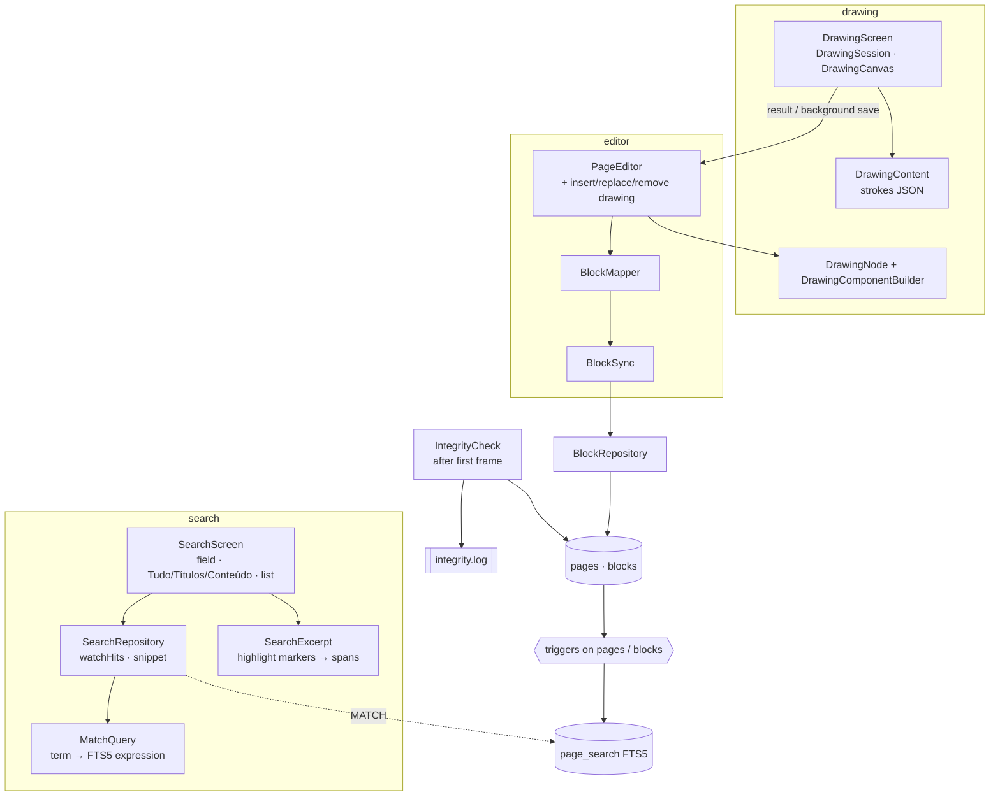
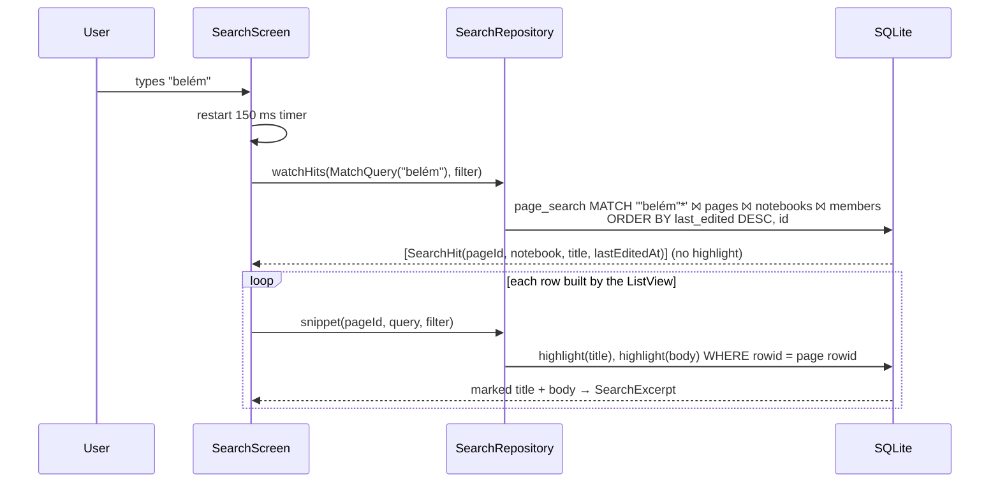

# M05 Search and Gate 1 Design

**Spec**: `.specs/features/m05-search-and-gate-1/spec.md`
**Context**: `.specs/features/m05-search-and-gate-1/context.md`
**Status**: Approved (2026-10-17, with the request to create tasks)

The two architectural choices were confirmed by the user on 2026-10-17: search uses **one FTS5 row per page**, kept current by SQL triggers, and the drawing is **a node of its own in `super_editor`**, saved by the existing `BlockSync`.

The APIs below were checked against these sources:

| Library | Source checked |
| --- | --- |
| Drift | Context7 docs (`/websites/drift_simonbinder_eu`: FTS5 in `.drift` files, `sql.options.modules`) |
| `sqlite3` 3.5.2 | Pub cache, `doc/hook.md`: the bundled SQLite is built with `SQLITE_ENABLE_FTS5`, and `hooks.user_defines.sqlite3.source` can pick `sqlite3mc` or `sqlcipher` |
| `super_editor` 0.3.0-dev.52 | Pub cache source: `BlockNode`, `NodeMetadata.isDeletable`, `ReplaceNodeRequest`, `InsertNodeAfterNodeRequest`, `DeleteNodeRequest` |
| `perfect_freehand` 2.5.2+1 | pub.dev archive: `getStroke(List<PointVector>, {StrokeOptions?})` returns the outline as `List<Offset>`; MIT |

The FTS5 tokenizer, the prefix queries, the triggers and `INSERT OR REPLACE` by rowid were tried on SQLite 3.46.1: `"bele"*` finds "Belém", `"lem"*` does not, `{title}:` restricts the column, and a block update re-indexes its page.

Pinned versions: Flutter 3.47.5, `drift` 2.35.2, `sqlite3` 3.5.2, `flutter_riverpod` 3.4.3.

---

## Architecture Overview

Five independent parts, each sharing only the database:

1. **Search.** A `page_search` FTS5 table is declared in `lib/core/database/search.drift`. SQL triggers on `pages` and `blocks` keep one row per page, with the same rowid as the page. `SearchRepository` builds the `MATCH` expression from the term and returns a reactive, ordered list of hits. A second query, run only for the rows on screen, returns the highlighted title and excerpt.
2. **Drawing.** `DrawingNode` is a new `super_editor` `BlockNode`. `BlockMapper` maps it to and from the `drawing` block type, and `BlockSync` saves it like any other block. `DrawingScreen` is a full-screen route that edits a `DrawingContent` and reports back through the `PageEditor`.
3. **Integrity check.** `IntegrityCheck` runs after the first frame and appends a line to `integrity.log`.
4. **Kill test.** A separate app entry point types into a real page and records every completed flush. A host script kills it, relaunches it and checks the database.
5. **Load.** A seed writes the 12,000-page library straight to SQLite. A profile-mode integration test measures LOAD-02 to LOAD-06, and a host test checks the query plans (LOAD-07).



Search query path (SRCH-03, LOAD-06):



---

## Code Reuse Analysis

### Existing Components to Leverage

| Component | Location | How to Use |
| --- | --- | --- |
| `JotSearchField` | `app/lib/core/design_system/jot_search_field.dart` | Search field: canvas `Campo de busca`; gains `autofocus` and `placeholder` |
| `JotSegmentedControl<T>` | `app/lib/core/design_system/jot_segmented_control.dart` | Tudo / Títulos / Conteúdo |
| `EmptyState` | `app/lib/core/design_system/empty_state.dart` | "Busque em todos os cadernos" and "Nenhuma página encontrada" |
| `JotIconButton`, `JotIconGlyph.search`, `.drawing` | `app/lib/core/design_system/` | "Buscar" button on Cadernos; "Desenho" in the bar |
| `RelativeDates.day` | `app/lib/core/text/relative_dates.dart` | Result date (same as the page rows) |
| `PageRepository._summaries` "last edited" expression | `app/lib/features/pages/data/page_repository.dart:166-175` | Extracted to one SQL fragment shared with search ordering (SRCH-10) |
| `PageScreen` / `PageEditor` | `app/lib/features/pages/presentation/page_screen.dart`, `app/lib/features/blocks/presentation/editor/page_editor.dart` | Result tap opens `PageScreen(pageId)`; the drawing goes through `PageEditor` |
| `BlockSync`, `BlockRepository.applyChanges` | `app/lib/features/blocks/presentation/editor/block_sync.dart`, `app/lib/features/blocks/data/block_repository.dart` | Insert, update and soft delete of drawing blocks with no new write path |
| `ActiveBlockBuilder` | `app/lib/features/blocks/presentation/editor/components/active_block_builder.dart` | Wraps the drawing card like other blocks; the drag handle is hidden for drawings (Out of Scope) |
| `BlockBar` | `app/lib/core/design_system/block_bar.dart` | Gains the "Desenho" button (DRAW-01), as an action rather than a type state |
| `launch_to_new_page_test.dart` helpers (`_pumpUntil`), `perf_driver.dart` | `app/integration_test/perf/`, `app/test_driver/` | Same timing method for LOAD-02 to LOAD-06; the driver gets a per-test output name |
| `createTestDatabase`, `pumpJot`, `FakeClock`, `SequentialIdGenerator`, `StreamRecorder` | `app/test/helpers/` | Every new test |
| `drift_dev make-migrations` + `SchemaVerifier` | `app/test/drift/` | v2 → v3 migration test (SRCH-19, DOC-01) |

### Integration Points

| System | Integration Method |
| --- | --- |
| Drift schema | `schemaVersion` 3. `@DriftDatabase(include: {'search.drift'})` adds `page_search` and its 5 triggers. `from2To3` creates them and backfills every page with one `INSERT … SELECT` |
| `build.yaml` | `drift_dev.options.sql: {dialect: sqlite, options: {modules: [json1, fts5]}}`, so the `.drift` file and custom queries are analyzed |
| `pubspec.yaml` | `perfect_freehand: 2.5.2+1` exactly (an exact pin, as with `super_editor`); `package_info_plus` for the integrity log's app version |
| l10n | `searchLabel` "Buscar", `searchPlaceholder` "Buscar em todos os cadernos", `searchFieldLabel` "Buscar em títulos e conteúdo", `searchCancel` "Cancelar", `searchScopeLabel` "Onde buscar", `searchAll` "Tudo", `searchTitles` "Títulos", `searchContent` "Conteúdo", `searchEmptyTitle` "Busque em todos os cadernos", `searchEmptyBody` (canvas text), `searchNoResultTitle` "Nenhuma página encontrada", `searchNoResultBody(term)`, `searchCount(n)` plural "1 página"/"N páginas"; `blockTypeDrawing` "Desenho", `drawingCancel` "Cancelar", `drawingDone` "Concluir", `drawingUndo` "Desfazer traço", `drawingRedo` "Refazer traço", `drawingTools` "Ferramentas de desenho", `drawingPen` "Caneta", `drawingHighlighter` "Marca-texto", `drawingEraser` "Borracha", `drawingThin` "Traço fino", `drawingMedium` "Traço médio", `drawingThick` "Traço grosso", `drawingInk` "Tinta preta", `drawingBlue` "Azul", `drawingTerracotta` "Terracota", `drawingCardLabel` "Desenho", `drawingAreaLabel` "Área de desenho" |
| Canvas icons | New `JotIconGlyph` values traced from the artboards: `undo`, `redo`, `pen`, `highlighter`, `eraser`, `searchNone` (magnifier with an ×) |
| App start | `JotlineApp` schedules `IntegrityCheck.run()` with `addPostFrameCallback` and never awaits it on a frame (INTEG-01) |

---

## Components

### Search

#### `search.drift`: `lib/core/database/search.drift`

- **Purpose**: The full-text index of pages and the triggers that keep it current (SRCH-18).
- **Schema**:

  ```sql
  CREATE VIRTUAL TABLE page_search USING fts5(
    title, body, tokenize = 'unicode61 remove_diacritics 2'
  );
  ```

  - The rowid equals `pages.rowid`.
  - `body` holds the text of the page's blocks that are not deleted, of types `text`, `heading`, `bulleted_list_item` and `checklist_item`, in `position, id` order. Blocks are joined with U+2029 (PARAGRAPH SEPARATOR), which the tokenizer treats as a separator and the excerpt splits on.
  - Deleted pages and notebooks stay indexed; the search query filters them out. That keeps restore from the trash free (RF-12).
- **Triggers** (`AFTER`):
  - `pages_search_ai` on INSERT on `pages`;
  - `pages_search_au` on UPDATE OF `title` on `pages`;
  - `blocks_search_ai`, `blocks_search_au` and `blocks_search_ad` on `blocks`.

  Each one runs the same `INSERT OR REPLACE INTO page_search(rowid, title, body) SELECT …` for the page affected, built with `group_concat(json_extract(content_json, '$.text'), char(8233) ORDER BY position, id)`.
- **Tests**: `test/core/database/search_index_test.dart`, which runs these cases:
  - a block insert, update, soft delete and type change each re-index the page;
  - a drawing block never enters the body;
  - a page rename re-indexes the title;
  - a page with no blocks has an empty body.

#### `MatchQuery`: `lib/features/search/data/match_query.dart`

- **Purpose**: Turns the typed term into a safe FTS5 expression (SRCH-04, SRCH-05, EDGE-01, EDGE-02).
- **Interfaces**:
  - `enum SearchScope { all, titles, content }`
  - `final class MatchQuery { factory parse(String term); List<String> words; bool get isEmpty; String expression(SearchScope scope); }`
- **Rules**:
  - The term is split on every character that is not a letter or digit (`\p{L}\p{N}`, Unicode), which mirrors `unicode61`.
  - Each word becomes `"word"*`, with any `"` doubled.
  - Words are joined with ` AND `.
  - `titles` wraps the expression in `{title} : (…)` and `content` in `{body} : (…)`; `all` has no column filter.
  - FTS5 operators typed by the user (`OR`, `NEAR`, `-`, `*`, `"`) end up inside quotes, so they are plain text.
- **Tests**: `match_query_test.dart` covers accents, punctuation-only input, quotes, `OR` and `NEAR` as words, and emoji.

#### `SearchRepository`: `lib/features/search/data/search_repository.dart`

- **Purpose**: Reactive search over the local database (SRCH-03, SRCH-09, SRCH-10, SRCH-20, SRCH-21).
- **Interfaces**:
  - `Stream<List<SearchHit>> watchHits(MatchQuery query, SearchScope scope)`. Every hit is a page whose notebook has the local user as a member (archived included, RNF-09), with the page and the notebook not deleted. Hits are ordered by `last_edited_at DESC, p.id`. `customSelect` `readsFrom: {pages, blocks, notebooks, notebookMembers}` makes the stream re-emit on writes, because the triggers fire on the same writes.
  - `Future<SearchSnippet> snippet(String pageId, MatchQuery query, SearchScope scope)` runs `highlight(page_search, 0, '', '')` and `highlight(page_search, 1, …)` for one rowid, then `SearchExcerpt.from`.
- **Models** (`search_hit.dart`):
  - `SearchHit { String pageId; String title; String notebookTitle; NotebookColor notebookColor; DateTime lastEditedAt; }`
  - `SearchSnippet { List<TextSpanRange> title; SearchExcerpt? excerpt; }`
- **Shared SQL**: the "last edited" expression moves to `lib/core/database/last_edited_sql.dart`. `PageRepository` and `SearchRepository` both use it, so the two orderings cannot drift apart.
- **Tests**: `search_repository_test.dart` covers SRCH-04 to SRCH-10, SRCH-18 and SRCH-20 with the spec's Independent Test data.

#### `SearchExcerpt`: `lib/features/search/data/search_excerpt.dart`

- **Purpose**: Turns highlighted text into display spans and cuts the excerpt (SRCH-13, SRCH-14, EDGE-03, EDGE-04).
- **Rules**:
  - `title` is the highlighted title split into plain and marked spans.
  - The body is split on U+2029. The first segment with a `` marker is the matching block, which is the first in `position` order.
  - The excerpt window starts up to 40 characters before the first marker and runs to the end of the block. It is cut at word boundaries, with "…" added only on a side that was actually cut.
  - The 2-line limit is applied by the widget (`maxLines: 2`, ellipsis).
  - No marker in the body means `excerpt == null`.
- **Tests**: `search_excerpt_test.dart` covers a match at the start, in the middle and at the end, several marks, and a mark on the last block.

#### `SearchScreen`: `lib/features/search/presentation/search_screen.dart`

- **Purpose**: The "Busca local" artboard and its two empty states (SRCH-01, SRCH-02, SRCH-11 to SRCH-17).
- **State**:
  - A `TextEditingController`, the `SearchScope` and a 150 ms `Timer`; the debounced `MatchQuery` feeds a `StreamProvider.family` keyed by `(query, scope)`.
  - The rows are a `ListView.builder`. Each row (`SearchResultRow`) reads `searchSnippetProvider((pageId, query, scope))`, a `FutureProvider.family.autoDispose`, so highlights are computed only for the rows built.
  - The route keeps its state while `PageScreen` is pushed on top of it, which covers SRCH-16 (term, filter and scroll kept).
- **Entry**: the "Buscar" `JotIconButton` is the first action of the Cadernos top bar, in the canvas order Buscar · Ordenar · Lixeira.
- **Tests**: `search_screen_test.dart` (widget test with an in-memory database and a fake clock) and `integration_test/search_flow_test.dart` (E2E, RF-05). The testes.md flow table already lists "Search by title and content".

### Drawing

#### `DrawingContent`: `lib/features/blocks/data/drawing_content.dart`

- **Purpose**: The drawing's `content_json` (DRAW-19), with no field from the drawing library. Fixed in the drawing ADR.
- **Interfaces**:
  - `enum DrawingTool { pen('pen'), highlighter('highlighter') }`
  - `enum DrawingColor { ink('ink'), accent('accent'), danger('danger') }`
  - `enum StrokeWidth { thin(3), medium(6), thick(12) }`
  - `final class StrokePoint { double x, y, pressure; }`
  - `final class Stroke { DrawingTool tool; DrawingColor color; double width; List<StrokePoint> points; }`
  - `final class DrawingContent implements StoredContent { static const Size logicalSize = Size(390, 560); List<Stroke> strokes; factory fromJson(String); String toJson(); }`
- **JSON shape**: `{"strokes":[{"tool":"pen","color":"ink","width":3,"points":[[44.0,300.0,0.5],…]}]}`. Coordinates are rounded to 0.1 and pressure to 0.01. An unknown tool or color reads as `pen` or `ink`. A value that does not parse reads as no strokes, which covers EDGE-07.
- **Tests**: `drawing_content_test.dart` covers the round trip, rounding, unknown ids, invalid JSON and a single-point stroke.

#### `StoredContent` and `BlockType.drawing`: `lib/features/blocks/data/block_content.dart`

- `abstract interface class StoredContent { String toJson(); }` is implemented by `BlockContent` and `DrawingContent`.
- `Insert.content` and `Update.content` become `StoredContent`. `applyChanges` calls `forType` only on a `BlockContent`.
- `BlockType` gains `drawing('drawing')`. An unknown id still reads as `text` (ADR 0036).
- `PageRepository`'s excerpt already whitelists the text types, so DRAW-20 holds with no change there.

#### `DrawingNode` and `DrawingComponentBuilder`: `lib/features/blocks/presentation/editor/components/drawing_block.dart`

- **Purpose**: The drawing as a `super_editor` block, shown as the card (DRAW-12, DRAW-13).
- **`DrawingNode extends BlockNode`**: holds `DrawingContent`, and its metadata sets `NodeMetadata.isDeletable: false`. Keyboard deletion therefore never removes it; only an explicit `DeleteNodeRequest` from DRAW-15 does (context: removal only through erase + "Concluir"). `hasEquivalentContent` compares the content.
- **`DrawingComponentBuilder`**: renders `DrawingCard`, which is:
  - `AspectRatio(390 / 560)` with a 1 px `bgTrilho` border, radius `rCard`, on `bgFolha`;
  - a `CustomPaint` with `DrawingPainter` scaled to the card width;
  - wrapped in `Semantics(label: "Desenho", button: true)`.

  A tap calls `onOpen(nodeId)`, which the `PageEditor` supplies.
- **`BlockMapper`**: `toNode(BlockType.drawing, …)` builds a `DrawingNode`, and `fromNode(DrawingNode)` returns `(BlockType.drawing, DrawingContent)`. Its return type becomes `(BlockType, StoredContent)`.
- **`BlockSync`**: an insert is deferred only for a `BlockContent` with empty text; a drawing node is always inserted. Nothing else changes, because insert, replace and delete already emit `NodeDocumentChange` events.
- **`PageEditor`** gains:
  - `DrawingContent drawingOf(String nodeId)`;
  - `String insertDrawing(DrawingContent)`: inserts after the caret block, or replaces the caret block when it is an empty text block with no row (DRAW-10). Returns the node id;
  - `void replaceDrawing(String nodeId, DrawingContent)`: a `ReplaceNodeRequest` with the same id, so the block id is kept;
  - `void removeDrawing(String nodeId)`;
  - `onOpenDrawing`.

  Each mutation is followed by `flush()`, so DRAW-10, DRAW-14 and DRAW-15 are written at once rather than after 500 ms.
- **Tests**:
  - `block_mapper_test.dart` (drawing round trip);
  - `block_sync_test.dart` (insert, replace and delete write one `drawing` row, and `version` is unchanged);
  - `page_editor_test.dart` (insertion point);
  - a widget test for the card.

#### `DrawingSession`: `lib/features/blocks/presentation/drawing/drawing_session.dart`

- **Purpose**: The pure logic of the drawing mode (DRAW-04 to DRAW-09).
- **Interfaces**: `class DrawingSession with ChangeNotifier`, created from `DrawingContent original`, with:
  - `tool`, `width` and `color` (defaults Caneta, fino, Tinta preta);
  - `startStroke`, `extendStroke` and `endStroke(Offset logical, double pressure)`;
  - `erase(Offset logical)`;
  - `undo()` and `redo()`, plus `canUndo` and `canRedo`;
  - `DrawingContent get content` and `bool get isEmpty`.
- **Rules**:
  - The highlighter stores the selected width; the painter applies ×3 and 35 % opacity (DRAW-06).
  - The eraser removes every stroke that has a point or segment within `stroke.width / 2 + 10` logical units of the touch (DRAW-07).
  - Undo works on actions: one stroke added, or the set of strokes removed by one eraser drag (DRAW-08). A new action clears the redo stack.
- **Tests**: `drawing_session_test.dart`.

#### `DrawingScreen` and `DrawingPainter`: `lib/features/blocks/presentation/drawing/`

- **Purpose**: The "Modo desenho: tela cheia" artboard (DRAW-02 to DRAW-04, DRAW-11, DRAW-15 to DRAW-18).
- **Interfaces**:
  - `Future<void> openDrawing(BuildContext, {required DrawingTarget target})`;
  - `DrawingTarget { String? nodeId; DrawingContent original; DrawingSink sink; }`;
  - `abstract interface class DrawingSink { String save(String? nodeId, DrawingContent content); void remove(String nodeId); }`, implemented by `PageEditor`.
- **Flow**:
  - "Concluir" with strokes calls `sink.save`. With no strokes, it calls `sink.remove` when a node exists and does nothing for a new drawing.
  - "Cancelar" does nothing unless a background save happened. In that case it calls `sink.save(nodeId, original)` for an existing drawing, or `sink.remove(nodeId)` for a new one.
  - An `AppLifecycleListener` (`onInactive`/`onHide`/`onPause`, as in M04 SAVE rules) calls `sink.save` when the session has strokes, and keeps the returned `nodeId` (DRAW-17).
- **Canvas**: a `LayoutBuilder` fits the 390 × 560 logical area into the space between the header and the tools (`FittedBox`-like scale, centered), and the `Listener` converts pointer positions to logical coordinates (DRAW-03).
- **`DrawingPainter`**: each stroke goes through `getStroke` (`StrokeOptions(size: width × scale, simulatePressure: pressure == null)`) into a filled `Path`. The color comes from the token map `ink` → `ink1`, `accent` → `accent`, `danger` → `danger`; the highlighter is drawn at 35 % alpha. A single-point stroke draws as a dot (EDGE-06). The card and the screen share this painter.
- **Tests**: `drawing_screen_test.dart` (the spec's Independent Test and the background-then-cancel cases) and `drawing_painter_test.dart` (a scale test, no goldens).

#### `BlockBar` change

- The "Desenho" button is added after "Checklist", as in the canvas; it is never shown as active. `onDrawing` calls `openDrawing` with a new target (DRAW-01, DRAW-02).
- The BAR-03 test changes from "has no Desenho" to "Desenho opens the drawing mode".

### Integrity check

#### `IntegrityCheck`: `lib/core/database/integrity_check.dart`

- **Purpose**: The startup check and its local log (INTEG-01 to INTEG-08, EDGE-08).
- **Interfaces**:
  - `class IntegrityCheck { new(AppDatabase, Clock, IntegrityLog, String appVersion); Future<IntegrityReport> run(); }`
  - `IntegrityReport { bool passed; List<IntegrityFailure> failures; }`
  - `IntegrityFailure { String invariant; List<String> ids; }`
- **Checks**:

  | Invariant | Query |
  | --- | --- |
  | `sqlite_integrity` | `PRAGMA integrity_check`, everything other than `ok` |
  | `notebook_without_owner` | A non-deleted notebook with no `owner` member |
  | `orphan_page` | A page whose `notebook_id` is not in `notebooks` |
  | `orphan_block` | A block whose `page_id` is not in `pages` |
  | `duplicate_position` | Two non-deleted pages of a notebook, or two non-deleted blocks of a page, with the same `position` (`GROUP BY parent, position HAVING count(*) > 1`) |

  The checks only read the database (INTEG-08). Any exception becomes the failure `check_error` (INTEG-07).
- **`IntegrityLog`** (`lib/core/database/integrity_log.dart`): appends to `<application support>/integrity.log` and creates the file when missing. Line format: `2026-10-17T12:00:00Z 1.0.0+1 fail orphan_page=<id>,<id> duplicate_position=<id>`.
- **Wiring**: `integrityCheckProvider`. `JotlineApp` registers one `addPostFrameCallback` that calls `unawaited(check.run())`.
- **Tests**: `integrity_check_test.dart` (each invariant, with an in-memory database and a temporary directory for the log) and a widget test proving the first frame does not wait for it.

### Kill test

#### Instrumented entry point: `integration_test/kill/kill_app.dart`

- **Purpose**: Exercises the real save path under force-stop (KILL-01, KILL-02).
- **Behavior**:
  1. Opens the production database (`databaseProvider`).
  2. Verify step: when `kill/acks.jsonl` exists, it compares the page's non-deleted blocks (`position` order, `type`, `content_json`) with the last ack. A match with the ack's `pending` snapshot is also accepted, since a write can commit just before the kill. It runs `IntegrityCheck` (KILL-03) and appends the result to `kill/results.jsonl`.
  3. Type step: on a fixed page, it types scripted bursts through `PageEditor`: inserts, splits and type changes, seeded by the iteration number.
  4. Before each `flush()` it appends `{"pending": snapshot}`; after the flush completes it appends `{"ack": snapshot}`.
- **Build**: `fvm flutter build apk --profile -t integration_test/kill/kill_app.dart`. It ships in no release build.

#### Host script: `app/tool/kill_test.sh`

- **Purpose**: Runs 100 iterations and returns non-zero on any divergence (KILL-04, KILL-05).
- **Loop**:
  1. `adb shell am start` the app.
  2. Sleep a random delay of 0.5–6 s, printing the seed.
  3. `adb shell am force-stop`.
  4. Relaunch; the app runs the verify step before typing again.

  At the end, the script pulls `results.jsonl` with `adb exec-out run-as com.jon.jotline cat …` and prints `N/100 iterations, D divergences`, with the expected and actual content of each divergence.
- **Tests**: `tool/kill_test_test.sh` checks the result parser on a passing and a failing `results.jsonl`, which covers L-001: the message text is asserted, not only the exit code. The fault-injection case of the spec's Independent Test is run once by hand and recorded in the PR.

### Load

#### Seed: `integration_test/perf/seed_library.dart`

- **Purpose**: LOAD-01.
- **Data**:
  - One notebook with 10,000 pages and 20 notebooks with 100 pages each, all with the owner member row.
  - Every page has 20 `text` blocks of about 200 characters, drawn from a fixed pt-BR word list with a seeded `Random`. Every page contains the word "belém" once, for LOAD-06.
  - Writes go through batched `INSERT` in one transaction, with real fractional `position` keys from `FractionalIndex`, so the triggers also fill `page_search`.
- **Tests**: the host test `test/perf/seed_library_test.dart` (`@Tags(['perf'])`) seeds and checks the counts and the invariants with `IntegrityCheck`. `dart_test.yaml` declares the `perf` tag with `skip`, as testes.md requires.

#### Measurement: `integration_test/perf/large_library_test.dart`

- **Purpose**: LOAD-02 to LOAD-06 in profile mode on the device.
- **Method**:
  - Seed a file database once.
  - For each target, start a `Stopwatch` at the navigation call or the debounced query and `_pumpUntil` the first row is laid out. Pumps are 8 ms apart, as in PERF-01.
  - The scroll uses `binding.traceAction` with `scrollUntilVisible` over 2,000 rows; `average_frame_build_time_millis` comes from the timeline summary (LOAD-04).
  - `reportData` writes all values; `perf_driver.dart` takes the output name from the test.
- **Command** (added to `app/CLAUDE.md`, DOC-03): `fvm flutter drive --driver=test_driver/perf_driver.dart --target=integration_test/perf/large_library_test.dart --profile -d DEVICE_ID`.

#### Query plans: `test/core/database/query_plan_test.dart`

- **Purpose**: LOAD-07.
- **Method**: runs `EXPLAIN QUERY PLAN` on the notebook summaries, page summaries, block load, search hits and snippet queries over a small seed. It fails on any `SCAN pages` or `SCAN blocks` without `USING INDEX`. FTS5 virtual-table scans are expected and allowed. To make this possible, each repository exposes its SQL through a `@visibleForTesting` getter.

#### Policy when a target is missed (LOAD-09, user decision)

- The measurement tasks come **first** in the load phase, on the code as it stands plus the search query.
- When a target is missed, the only fix in scope is an index change, because #27 lists "Indexes adjusted". After one index attempt, if the target is still missed, the work stops. The user gets the measured values, the targets, the query plans and the friction, and decides the next step. No loop of optimizations runs without that decision.

### Encryption spike (#28)

- **Branch**: `spike/28-local-encryption`, never merged (CRYPT-01, CRYPT-05).
- **Starting point**: `sqlite3` 3.5.2 can bundle `sqlite3mc` or `sqlcipher` through `hooks.user_defines.sqlite3.source` (pub cache `doc/hook.md`). The spike tries both with Drift's `PRAGMA key` in `setup`.
- **PowerSync** (CRYPT-02): check the PowerSync Flutter docs on Context7 for its SQLCipher support and whether it shares the `sqlite3` hook or ships its own SQLite.
- **Measurements** (CRYPT-03):
  - converting an existing unencrypted database (`sqlcipher_export` or `VACUUM INTO`);
  - storing the key (`flutter_secure_storage` or the platform keystore);
  - APK and IPA size difference;
  - LOAD-03 and LOAD-06 with the encrypted seed.
- **Output**: ADR 0040, plus a mark on the PRD §11 checkbox with a link to it (CRYPT-04).

### Gate 1

- **`docs/gates/gate-1.md`** (Portuguese) has three sections with evidence links (GATE-01 to GATE-05):
  - the spike: ADR 0035 and the #67 issue comment;
  - the schema: `schemaVersion` 3 and ADRs 0004, 0005, 0013, 0036 and 0039;
  - no data loss: the kill test PR result, the summary of `integrity.log` pulled from the internal-use device, the period dates, the device, and the search link for the `data-loss` label.

  It ends with a verdict.
- **Label**: a `data-loss` issue label is created when the internal-use period starts.
- **GATE-06** is a process rule: a #67 failure blocks the verdict until a new ADR supersedes 0035.

---

## Data Models

### Schema v3

| Object | Kind | Notes |
| --- | --- | --- |
| `page_search(title, body)` | FTS5 virtual table | rowid = `pages.rowid`; `unicode61 remove_diacritics 2` |
| `pages_search_ai`, `pages_search_au` | triggers on `pages` | Re-index one page |
| `blocks_search_ai`, `blocks_search_au`, `blocks_search_ad` | triggers on `blocks` | Re-index the block's page |

No column changes. `blocks.type` gains the value `drawing`, which is data, not schema.

### Drawing block

```json
{"strokes":[{"tool":"highlighter","color":"accent","width":6,"points":[[60.0,470.0,0.5],[100.4,440.0,0.62]]}]}
```

---

## Error Handling Strategy

| Error Scenario | Handling | User Impact |
| --- | --- | --- |
| The term has FTS5 syntax characters | `MatchQuery` quotes every word | The search shows plain results |
| An FTS5 query throws anyway | `watchHits` emits an error; the screen shows the "sem resultado" state and logs `jotline.search` | No crash (EDGE-02) |
| Search screen popped mid-query | Providers are `autoDispose`; a late result is dropped | Nothing (EDGE-05) |
| Drawing `content_json` invalid | `DrawingContent.fromJson` reads no strokes and logs `jotline.editor` | An empty card (EDGE-07) |
| A drawing flush fails | `BlockSync` keeps the node touched and retries on the next flush (existing M04 rule) | Saved on the next edit or exit |
| The integrity check throws | It is logged as `check_error` | None; the app runs (INTEG-07) |
| The integrity log cannot be written | `developer.log` the error; nothing is shown | None |
| A kill test iteration diverges | The script prints the diff and exits 1 | CI or developer sees the failure |

---

## Risks & Concerns

| Concern | Location (file:line) | Impact | Mitigation |
| --- | --- | --- | --- |
| Notebook summaries aggregate every block of every notebook (`leftOuterJoin(blocks)` + `max`): ~200,000 rows for the 10,000-page notebook | `app/lib/features/notebooks/data/notebook_repository.dart:183-240` | LOAD-02 likely over 100 ms | Measured first. An index on `blocks(page_id, updated_at, deleted_at)` is the only fix in scope; anything else is reported to the user (LOAD-09 policy) |
| Page summaries run 3 correlated subqueries per page, and the stream emits all 10,000 rows on every block write | `app/lib/features/pages/data/page_repository.dart:160-195` | LOAD-03 and a re-query on every save of any page | Same as above; options for the report: a windowed query, or a derived cache (it would need a new ADR next to ADR 0037) |
| Search ordering computes "last edited" for every hit (up to 12,000 for "belém" in the seed) | New search query | LOAD-06 | Highlights are deferred to visible rows; ordering is measured, and a miss is reported |
| The FTS rowid is tied to `pages.rowid`, which a `VACUUM` could renumber on a table without an `INTEGER PRIMARY KEY` | `app/lib/core/database/tables/pages.dart` | Index points to the wrong page after a `VACUUM` | The app never runs `VACUUM`; the search ADR records the rule, and that a `VACUUM` requires a full re-index |
| Phase 2: PowerSync manages tables as views, so triggers on our tables may not fire on synced writes | ADR 0002, PRD §6 | Search misses synced changes | Recorded in the search ADR as a phase 2 item; the index can be rebuilt from the same `SELECT` |
| `ReplaceNodeRequest` with the same node id emits `NodeRemovedEvent` and `NodeInsertedEvent` for that id | `super_editor` `multi_node_editing.dart:658` | `BlockSync` could see a delete and an insert | `BlockSync` checks node existence at flush time, so it writes an `Update`; covered by a `block_sync_test` case |
| Default keyboard actions delete block nodes on Backspace | `super_editor` defaults | A drawing removed by the keyboard, contrary to the spec | `isDeletable: false` on `DrawingNode`, with a widget test that presses Backspace below and above a drawing |
| `BlockMapper.fromNode` maps any non-text node to empty text | `app/lib/features/blocks/presentation/editor/block_mapper.dart:55` | A drawing saved as empty text | `fromNode` handles `DrawingNode` first, with a test |
| No app version is available at runtime | `app/pubspec.yaml` | INTEG-06 needs it | `package_info_plus` |
| The kill test needs `run-as`, which works only on debuggable or profile builds | `tool/kill_test.sh` | Pulling results fails on a release build | The script builds `--profile`; recorded in the command docs |

---

## Tech Decisions (only non-obvious ones)

| Decision | Choice | Rationale |
| --- | --- | --- |
| Index granularity | One FTS5 row per page (`title`, `body`) | User decision; AND across title and content (SRCH-08) with no aggregation |
| Index upkeep | SQL triggers on `pages` and `blocks` | Any writer stays consistent, including the migration backfill; no Dart code path can forget it |
| Deleted rows in the index | Kept; the query filters them | Restoring from the trash needs no re-index |
| Excerpt source | `highlight()` on the body, split on U+2029, cut in Dart | The FTS5 tokenizer decides what matched, so Dart never re-implements accent folding |
| Highlight loading | Per visible row (`FutureProvider.family.autoDispose`) | `highlight()` over thousands of bodies would break LOAD-06 |
| Drawing in the editor | `DrawingNode` (`BlockNode`, not deletable by keys) saved by `BlockSync` | User decision; one writer of block order per open page |
| Drawing writes | Flush right after insert, replace or remove | DRAW-10/14/15: one write at "Concluir", not 500 ms later |
| Coordinates | Logical 390 × 560, rounded to 0.1 | Same drawing on every screen; smaller JSON |
| Version source for the log | `package_info_plus` | The app has no runtime version today |
| ADR numbers | 0038 local search, 0039 drawing block, 0040 local encryption | Next free numbers |

No project-level `AD-NNN` entry: `.specs/STATE.md` does not exist yet, and these decisions go to ADRs as the project requires.
